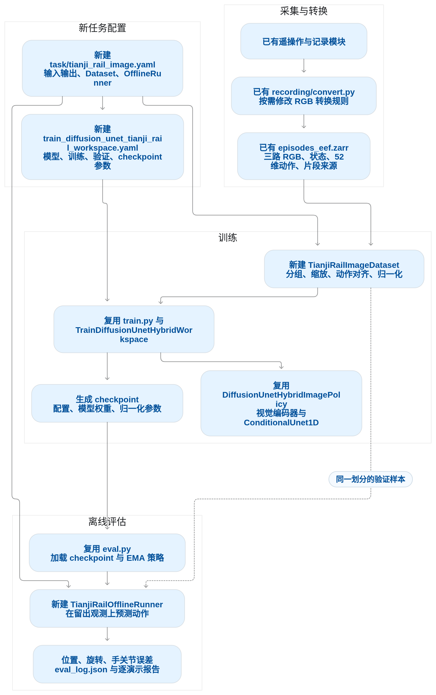

# 对话背景信息设定

输出对话请按照以下要求：

1. 短内容直接输出到对话内。
2. 长段内容(比如包含三张以上图片、多个示例和大量说明)输出到单独的mardown文档中，存在 @diffusion_policy/wys 目录下本次对话的文件夹中，在对话窗口只输出概要、文件链接、Mermaid 图的png格式图片/链接等。总之，防止同一个对话积累了很多长回答、Mermaid 图和工具记录，历史加载与渲染，导致每次加载太慢。
3. 计划的markdow文件，输出到  diffusion_policy/plan/ 目录下面。

生成的Mermaid 的png图类似下面的就行，不要花里胡哨的。

