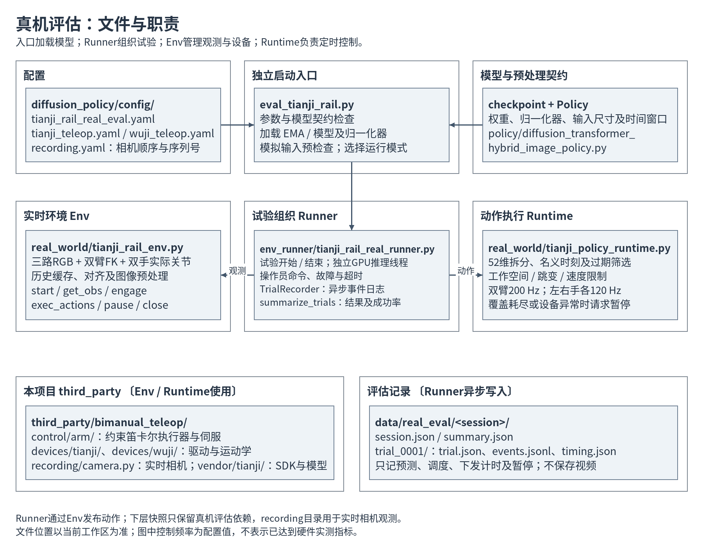
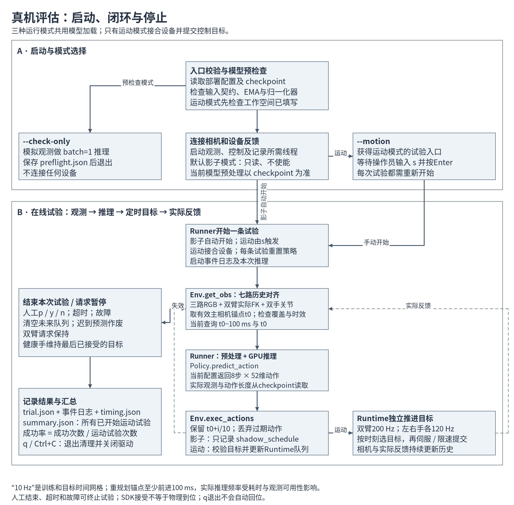

# 当前真机评估：文件结构与运行流程

核对日期：2026-10-16。当前训练与策略时间网格为10 Hz，部署前检查checkpoint频率一致。真机评估从 `eval_tianji_rail.py` 启动，核心分为**试验组织 Runner、实时环境 Env、动作执行 Runtime**。三者在同一 Python 环境中运行，模型预处理和推理由独立进程执行，设备控制与记录由独立线程调度。

## 1．文件结构



```text
diffusion_policy/                          # 项目根目录
├── eval_tianji_rail.py                    # 真机评估独立入口
├── conda_environment_tianji.yaml          # 环境：tianji-rail-diffusion-policy
├── diffusion_policy/
│   ├── config/
│   │   ├── tianji_rail_real_eval.yaml      # 部署时序、限制、工作空间与记录配置
│   │   ├── tianji_teleop.yaml             # 天机双臂设备与控制配置
│   │   ├── wuji_teleop.yaml               # 无极双手地址、参数与反馈配置
│   │   └── recording.yaml                 # 三路实时相机的序列号与顺序
│   ├── real_world/
│   │   ├── tianji_rail_env.py             # 实时观测、设备生命周期、动作发布接口
│   │   └── tianji_policy_runtime.py       # 目标队列、校验、独立控制及暂停
│   ├── env_runner/
│   │   └── tianji_rail_real_runner.py     # 试验、推理线程、异步记录与汇总
│   ├── policy/
│   │   └── diffusion_transformer_hybrid_image_policy.py
│   └── model/                            # 观测编码器、Transformer、归一化等
├── third_party/bimanual_teleop/           # 本项目保存的设备接口快照
│   ├── control/arm/{cartesian,servo}.py   # 笛卡尔执行器及受约束伺服
│   ├── devices/tianji/                    # 驱动、运动学及SDK适配
│   ├── devices/wuji/                      # 无极手SDK会话与驱动
│   ├── recording/{camera,config,sink}.py  # 实时相机、配置与样本结构
│   ├── vendor/tianji/                    # 厂家SDK、原生库、模型和许可证
│   └── manifest.json                     # 快照来源与文件摘要
└── tests/
    ├── test_tianji_rail_real_eval.py       # 假设备、时序、停止与记录检查
    └── test_tianji_rail_standalone.py      # 本地资源与快照完整性检查
```

当前模型项目已经移除离线数据整理、转换入口。`third_party` 的 `recording/` 名称沿用源代码，但这里保留的是实时相机及其依赖，不能把它当作训练数据转换模块。真机评估所需设备接口在本项目内部，不需要运行另一套设备服务。

| 模块 | 主要职责 | 关键接口 |
| --- | --- | --- |
| [入口](../../../eval_tianji_rail.py) | 读取部署配置和checkpoint；检查52维契约；加载模型／EMA与保存的归一化器；执行模拟输入预检查；建立Env与Runner | `load_policy()`、`check_inference()`、`main()` |
| [Runner](../../../diffusion_policy/env_runner/tianji_rail_real_runner.py) | 组织每条试验，处理终端命令、超时和故障；在推理线程中读观测并调用Policy；异步保存结果 | `_begin()`、`_infer()`、`_end()`、`run()`；同文件含`TrialRecorder` |
| [Env](../../../diffusion_policy/real_world/tianji_rail_env.py) | 管理相机、双臂和双手；缓存实际反馈；对齐与预处理观测；接合、发布动作及关闭设备 | `start()`、`get_obs()`、`engage()`、`exec_actions()`、`pause()`、`close()` |
| [Runtime](../../../diffusion_policy/real_world/tianji_policy_runtime.py) | 筛选未来目标、整批校验、更新队列；独立推进双臂及双手；检查过期和健康状态 | `future_actions()`、`validate_actions()`、`submit()`、`tick()`、`pause()` |
| [Policy](../../../diffusion_policy/policy/diffusion_transformer_hybrid_image_policy.py) | 观测编码、条件扩散采样、动作反归一化；使用训练保存的模型参数 | `predict_action()`、`reset()` |

文件图的“Runner → Runtime”表示动作传递关系，实际调用为 **Runner → Env.exec_actions() → Runtime.submit()**。

## 2．启动与运行模式



入口先解析配置和checkpoint，核对输入、动作维度及支持的时间约定，加载模型并用模拟输入检查推理。随后按参数进入不同路径：

| 模式 | 设备连接 | 运动与结果 |
| --- | --- | --- |
| `--check-only` | 不连接设备 | 模拟输入推理后保存`preflight.json`并退出；用于检查模型加载与接口 |
| 默认影子模式 | 读取真实相机和设备反馈 | 不配置运动参数、不使能或提交运动目标；自动开始一条限时试验，预测与未来时刻写入日志 |
| `--motion` | 读取真实反馈，并允许操作员开始控制 | 启动前要求配置左右臂工作空间；输入`s`并按Enter后接合设备、开始本次试验 |

影子模式执行未来时间筛选，但不经过运动模式的整批工作空间、跳变及速度校验。因此影子模式正常结束，也不能直接判定运动目标已经通过这些限制。

## 3．闭环怎样运行

1. **持续采集实际反馈。** 三路RGB分别进入缓存。双臂每侧7个实际关节经FK得到各自基座系下的法兰位姿；双手每侧20个实际关节进入缓存。不会用上次预测代替实际反馈。
2. **构造观测。** `get_obs()`选择四路低维历史都能覆盖的最新主相机时刻`t0`。当前训练配置使用两步观测，查询`t0−0.1 s`与`t0`；图像最近时间匹配，位置和手关节线性插值、旋转SLERP插值。检查图像年龄、三路时间跨度、状态覆盖和插值间隔，禁止越过缓存端点外推。
3. **预处理并推理。** Runner按照checkpoint的RGB尺寸、缩放和归一化配置组装输入。当前配置为三路480×640 RGB、12维双臂末端位姿、40维双手关节；Policy生成16步完整动作预测，返回其中8步执行段。实际窗口与返回长度以checkpoint为准。
4. **保留名义时刻。** 返回的第`i`步执行动作对应`t0+i/10 s`。推理后丢弃已经过期或不足提交余量的步骤，不把整个预测序列平移到“推理完成之后”。8步最后目标在700 ms，覆盖至800 ms。顺序固定为左臂6、右臂6、左手20、右手20；位置为米，rotvec和手关节为弧度，均为绝对目标。
5. **定时执行。** 运动模式先校验整批剩余目标，再替换未来队列。Runtime按当前时刻选择已经到时的目标并分段保持；双臂交给受约束伺服，双手在实际提交前限速。Runtime没有对新旧两段预测做线性融合。
6. **重规划。** 真实反馈持续更新缓存，为下一轮观测提供依据。`replanning_steps=1`表示新锚点至少前进100 ms才发起下一轮推理，并不保证实际推理频率固定为10 Hz；推理耗时和观测可用性仍会限制频率。

| 并行工作 | 当前名义配置 | 含义 |
| --- | --- | --- |
| RGB采集 | 每路30 Hz | 相机画面持续到达，不保证三路同时曝光 |
| 状态历史采样／FK | 100 Hz | 检查最新状态并更新历史，不是设备原始反馈率 |
| 策略时间网格 | 10 Hz | 观测间隔和动作名义时刻；不是GPU调用频率 |
| 双臂控制 | 200 Hz | 一条双臂控制线程，每次读取当前目标并提交 |
| 双手控制 | 每侧120 Hz | 左右手分别运行独立线程 |
| 试验记录 | 独立异步线程 | 只写预测、调度、下发计时和暂停事件；队列满时丢弃计数，不影响控制 |

多轮目标衔接与过期示例见[运行时间轴](../task_flow_explanation/real_runtime_timing.md)。Python线程周期需要现场测量；SDK接受回执不等于物理到位，当前没有启用经过实测标定的动作提前补偿。

## 4．停止与评估产物

终端命令均需按Enter：`s`开始，`p`暂停并记接管，`y`记成功，`n`记失败，`q`退出。成功由操作员标注，当前没有自动识别导轨放置成功的视觉判定器。

人工结束、超时、观测失效、目标覆盖耗尽或设备拒绝等会触发相应结束／暂停路径；日志丢弃或写入失败只记入 `trial.json`，不会触发暂停。控制线程能够在覆盖耗尽或健康检查失败时独立请求暂停，不必等待GPU返回；停止后清空未来目标，当前试验的迟到预测作废。双臂请求保持，健康手继续发送最后已接受目标。退出关闭驱动并禁用双手，不自动回位。请求暂停不等于已经确认机械运动停止。

```text
data/real_eval/<session>/                 # 默认目录；--output可指定新目录
├── session.json                         # 模型标识、配置、SDK及版本
├── summary.json                         # 所有试验结果与成功率
└── trial_0001/
    ├── trial.json                       # 模式、结果、原因、丢弃事件数及日志错误
    ├── events.jsonl                     # 预测、调度、下发计时、暂停
    └── timing.json                      # 推理与下发的主机侧耗时、间隔及分位数
```

预检查模式只生成`preflight.json`；部署不保存视频。日志文件随试验进行而创建，日志写入失败时不生成`timing.json`。成功率分母为所有已开始的运动试验，包含失败、超时、接管和设备中止；影子试验不计入分母，没有运动试验时为`null`。

## 5．当前状态与使用入口

本次只核对当前源码并生成图示，没有加载模型、连接设备或执行运动。当前[部署配置](../../../diffusion_policy/config/tianji_rail_real_eval.yaml)中左右臂`workspace`仍为`null`，运动模式会拒绝启动；需现场填写并完成真实观测、时效、停止和短时闭环验收。设备约定见[设备运行说明](../device-runtime.md)，执行命令见[快速使用](../README.md#5真机评估)。

PNG与Mermaid源码使用[同一绘图规格](render_diagrams.py)生成；复现：在项目环境执行`python docs/tianji-rail/real_eval_structure/render_diagrams.py`。仅重新绘图，不运行真机评估。
