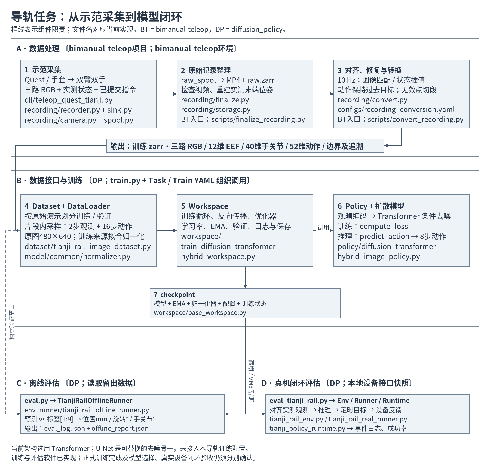
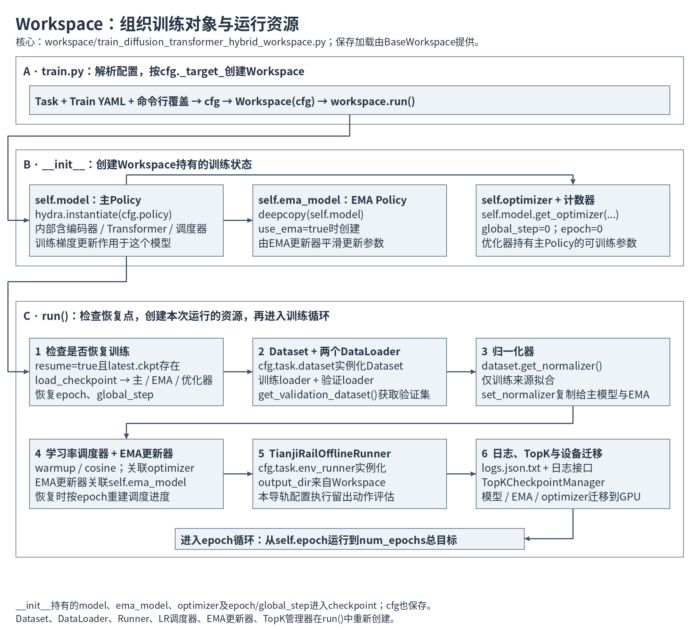
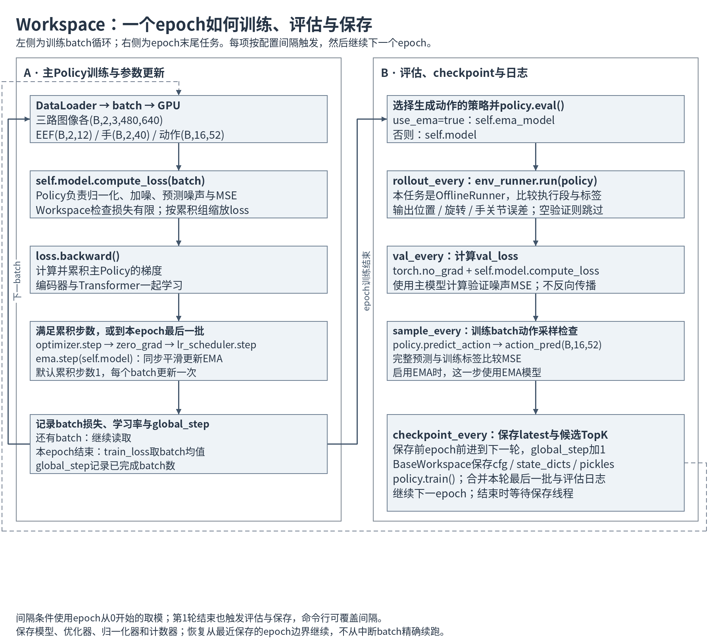
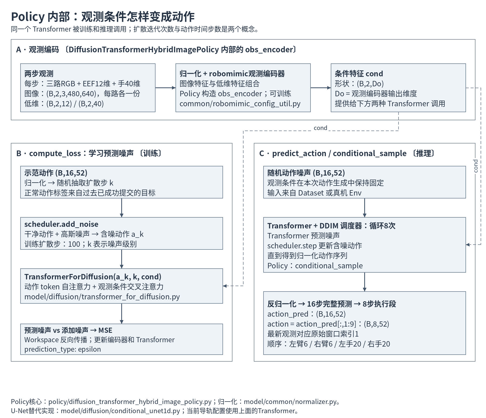
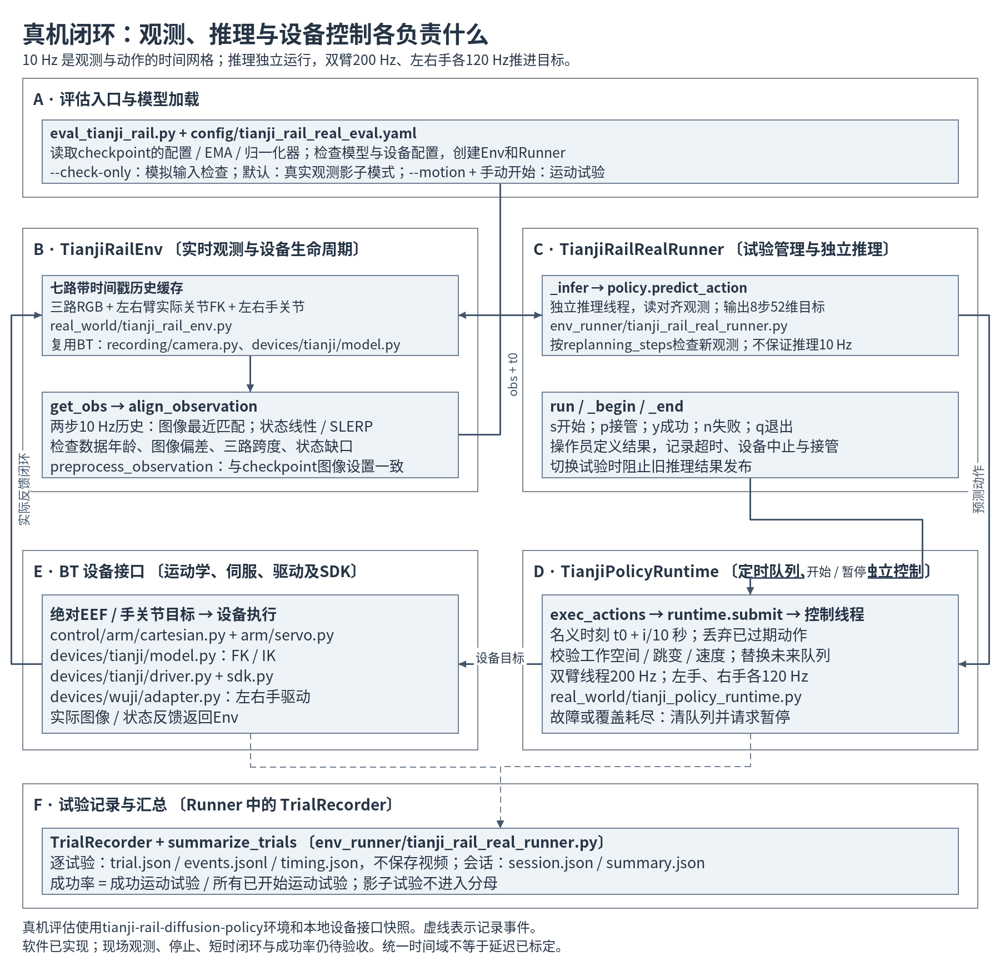

# 导轨任务完整实现流程与组件文件

核对日期：2026-10-05。依据三个关联任务的记录及当前源码，描述现有实现。图中的框表示组件职责边界，实线表示主要数据或调用流，虚线表示验证数据、条件输入或日志事件，具体含义见各图。

当前导轨任务使用 **Transformer Diffusion Policy**。完整链路为：示范采集 → 整理原始记录 → 时间对齐与修复 → 训练 zarr → Dataset / DataLoader → Workspace / Policy 训练 → checkpoint → 离线评估或真机闭环评估。

采集、整理和转换在 `bimanual-teleop` 项目及其环境中完成；`diffusion_policy` 在 `tianji-rail-diffusion-policy` 环境中直接读取训练zarr，负责Dataset、训练、离线评估和真机评估。两个项目通过训练数据文件交接；真机评估使用模型项目保留的实时相机与设备接口快照。

## 1. 完整流程

### 项目分工与数据交接

| 项目 | 职责 | 使用说明 |
| --- | --- | --- |
| bimanual-teleop | 采集、整理、审片、转换并输出训练zarr；使用 `bimanual-teleop` 环境 | [数据采集操作](../../../../bimanual-teleop/docs/recording_guide.md)、[数据格式与转换参考](../../../../bimanual-teleop/docs/recording_reference.md) |
| diffusion_policy | 读取训练zarr，划分训练／验证、训练模型、离线评估和真机评估；使用 `tianji-rail-diffusion-policy` 环境 | [模型使用说明](../README.md) |

当前数据交接路径为 `../bimanual-teleop/datasets/rail_place.zarr`（相对于模型项目根目录）。模型Dataset读取三路RGB、末端位姿、手关节、52维绝对EEF动作，以及来源与连续片段边界。数据处理规则以采集项目说明为准。

### 数据接口与训练组件

| 组件 | 负责的工作与交接产物 | 核心实现文件 |
| --- | --- | --- |
| 配置与训练入口 | Task 定义观测、动作、Dataset、OfflineRunner；Train 定义 Workspace、Policy、优化器、EMA 和训练参数；Hydra 合并配置并创建 Workspace | [train.py](../../../train.py#L25)、[Task YAML](../../../diffusion_policy/config/task/tianji_rail_image.yaml)、[Train YAML](../../../diffusion_policy/config/train_diffusion_transformer_tianji_rail_workspace.yaml) |
| Dataset | 按原始演示来源划分训练和验证；仅在连续片段内取完整窗口；按需读取 RGB，输出张量 | [tianji_rail_image_dataset.py](../../../diffusion_policy/dataset/tianji_rail_image_dataset.py#L16) |
| DataLoader | 将窗口样本组成 batch，处理训练打乱、读取进程和数据传输；由 Workspace 创建 | [train_diffusion_transformer_hybrid_workspace.py](../../../diffusion_policy/workspace/train_diffusion_transformer_hybrid_workspace.py#L82) |
| Normalizer | Dataset 只使用训练来源拟合低维观测和动作归一化参数；Policy 保存并使用，评估沿用 checkpoint 参数 | [Dataset.get_normalizer](../../../diffusion_policy/dataset/tianji_rail_image_dataset.py#L115)、[normalizer.py](../../../diffusion_policy/model/common/normalizer.py) |
| Workspace | 管理训练循环、反向传播、优化器、学习率、EMA、验证、周期性离线评估、动作采样检查和 checkpoint | [train_diffusion_transformer_hybrid_workspace.py](../../../diffusion_policy/workspace/train_diffusion_transformer_hybrid_workspace.py#L35) |
| Policy | 组合观测编码器、Transformer、扩散调度器和归一化器；提供 compute_loss 与 predict_action | [diffusion_transformer_hybrid_image_policy.py](../../../diffusion_policy/policy/diffusion_transformer_hybrid_image_policy.py#L24) |
| Transformer 去噪骨干 | 将动作时刻编码为 token，融合动作间关系、观测条件与扩散步，输出噪声预测 | [transformer_for_diffusion.py](../../../diffusion_policy/model/diffusion/transformer_for_diffusion.py) |
| EMA 与 checkpoint | EMA 平滑模型参数；checkpoint 保存主模型、EMA、优化器、计数器和配置，Policy 状态包含归一化器 | [ema_model.py](../../../diffusion_policy/model/diffusion/ema_model.py)、[base_workspace.py](../../../diffusion_policy/workspace/base_workspace.py) |

当前实际配置保留 480×640 原图，不缩放、不裁剪；正式 DataLoader 配置为 batch=32、4 个 worker。Task 默认 `val_ratio=0`，多来源正式训练通过命令行覆盖为 `0.1`；是否存在独立验证集取决于该实验保存的配置。片段不足 16 帧时不产生样本，不复制端点凑窗口。

## 2. Workspace：训练过程的组织者

**Workspace 负责把 Dataset、Policy、优化器、EMA、评估器和保存机制组织成一次训练实验。** Dataset 提供数据，Policy 定义损失和动作生成；Workspace 决定何时读取、反向传播、更新参数、评估和保存。导轨配置使用 [TrainDiffusionTransformerHybridWorkspace](../../../diffusion_policy/workspace/train_diffusion_transformer_hybrid_workspace.py#L35)，checkpoint 的保存加载由父类 [BaseWorkspace](../../../diffusion_policy/workspace/base_workspace.py#L13) 实现。

### 对象创建与运行资源

[train.py](../../../train.py#L25) 先解析合并后的配置，再由 `cfg._target_` 找到 Workspace 类，执行 `workspace = cls(cfg)` 和 `workspace.run()`。这个过程分两个阶段：

| 阶段 | 创建或处理的对象 | 代码位置 |
| --- | --- | --- |
| `__init__`：持久训练状态 | 设置随机种子；创建主 Policy；启用 EMA 时复制一份 Policy；通过主 Policy 的 `get_optimizer` 创建分组优化器；初始化 `epoch` 与 `global_step` | [Workspace.__init__](../../../diffusion_policy/workspace/train_diffusion_transformer_hybrid_workspace.py#L38) |
| `run`：恢复点与数据 | 检查当前输出目录的 `latest.ckpt`；创建 Dataset、训练/验证 DataLoader；仅用训练来源拟合归一化器并复制到主 Policy 和 EMA | [恢复和数据准备](../../../diffusion_policy/workspace/train_diffusion_transformer_hybrid_workspace.py#L74) |
| `run`：调度与评估资源 | 创建学习率调度器、EMA更新器、OfflineRunner、日志接口、TopK管理器，将模型和优化器状态迁移到指定设备 | [调度与运行资源](../../../diffusion_policy/workspace/train_diffusion_transformer_hybrid_workspace.py#L98) |
| `run`：训练循环 | 从保存的 `self.epoch` 运行到 `training.num_epochs` 总目标，处理每个batch和epoch末尾任务 | [训练循环](../../../diffusion_policy/workspace/train_diffusion_transformer_hybrid_workspace.py#L158) |

主 Policy 和 EMA Policy 是两个模型对象：主模型接受梯度更新，EMA模型由参数的滑动平均更新。`self.ema_model` 是模型副本，局部变量 `ema` 是管理更新规则的 `EMAModel`，两者作用不同。优化器参数包含观测编码器和 Transformer，分组设置来自 [Policy.get_optimizer](../../../diffusion_policy/policy/diffusion_transformer_hybrid_image_policy.py#L302)。

归一化器由 Dataset 拟合，但最终存入 Policy，因此它随模型进入 checkpoint。即使是恢复训练，`run()` 也会依据本次启动的数据再次调用 `get_normalizer()`；恢复时应保持原数据、来源划分和配置。

### 一个epoch的执行流程

训练batch经过 `compute_loss → backward → optimizer.step`。其中损失的具体计算由 Policy 完成，Workspace 负责调用、检查损失是否有限以及反向传播。默认 `gradient_accumulate_every=1`，每个batch更新参数；若设置为大于1，则先累积梯度，到组末或本epoch最后一批时更新，末尾不足一组的batch也会正常处理。每次优化器更新后推进学习率调度器，并更新EMA。

epoch末尾有三种不同评估，不能把它们混作一个指标：

| 任务 / 指标 | 输入与比较对象 | 使用的模型 | 触发配置 |
| --- | --- | --- | --- |
| 验证噪声损失 `val_loss` | 验证batch加噪后，比较噪声预测与目标噪声；不反向传播 | **主 Policy `self.model`** | `training.val_every` |
| 离线动作误差 | 留出观测生成8步执行段，与示范标签 `[1:9]` 比较位置、旋转和手关节误差 | 启用EMA时用 **EMA Policy** | `training.rollout_every` |
| 训练动作采样检查 `train_action_mse_error` | 使用缓存的第一个训练batch观测，生成完整16步动作，与完整标签计算MSE | 启用EMA时用 **EMA Policy** | `training.sample_every` |

源码先选择生成动作的 `policy` 并调用 `policy.eval()`，再依次执行离线Runner、验证损失和训练动作采样。[验证损失代码](../../../diffusion_policy/workspace/train_diffusion_transformer_hybrid_workspace.py#L230) 仍直接调用 `self.model.compute_loss`；开启EMA时，前面的 `eval()` 作用于EMA副本，不能据此认为主模型也切换到了eval模式。

导轨配置中的 `rollout` 实际调用 `TianjiRailOfflineRunner`，不会控制真机运动。没有独立验证窗口时Runner明确跳过；如果TopK配置监控 `val_loss`，但验证集没有窗口，Workspace在开始训练前报错。

按当前 [正式训练配置](../../../diffusion_policy/config/train_diffusion_transformer_tianji_rail_workspace.yaml)，验证每1轮、训练动作采样检查每5轮、离线Runner每50轮、checkpoint每10轮。这些条件使用从0开始的 `epoch % 间隔 == 0`，因此第一轮结束就会执行相应任务；例如间隔10的保存点为内部epoch 0、10、20……，对应已完成第1、11、21……轮。实际实验以命令行覆盖和checkpoint配置为准。

`global_step` 随完成的训练batch增长，最后一批在epoch末尾递增；它并不是优化器更新次数。开启梯度累积后，两者尤其不能互换。`train_loss` 是本epoch已运行batch损失的均值。

### checkpoint保存与恢复

[保存逻辑](../../../diffusion_policy/workspace/train_diffusion_transformer_hybrid_workspace.py#L267) 在写入checkpoint前，将 `epoch` 前进到下一轮，避免恢复时重复已完成的一轮。父类 [save_checkpoint](../../../diffusion_policy/workspace/base_workspace.py#L35) 打包如下内容：

| checkpoint字段 | 内容与用途 |
| --- | --- |
| `cfg` | 训练配置；独立评估据此重新构造Workspace和Policy |
| `state_dicts` | 主Policy、EMA Policy、优化器状态；Policy状态内含归一化参数 |
| `pickles` | `epoch`、`global_step`及输出目录等显式包含的值 |

`latest.ckpt` 保存最近一次触发保存的训练状态；[TopKCheckpointManager](../../../diffusion_policy/common/checkpoint_util.py#L4) 按监控损失选择候选checkpoint。当前配置留出验证时监控 `val_loss`，否则监控 `train_loss`，损失越低越好，`k=3`；TopK筛选也只在触发checkpoint保存时执行。

恢复训练通过 `training.resume=true` 加载同一输出目录中的 `latest.ckpt`。Dataset、DataLoader、Runner、日志和TopK管理器重新创建；学习率调度器与EMA更新器按恢复的epoch和每轮更新次数重建进度。它们不是直接恢复一个完整运行中的Python进程，checkpoint也不包含随机数生成器和DataLoader迭代器状态。续跑从最近保存的epoch边界开始，不能从中断batch精确继续；`num_epochs`表示总目标轮数。若要求恢复但当前目录不存在latest，现有逻辑会继续新训练，因此需先核对文件和目录。

Workspace在训练结束时等待保存线程；当前代码没有保证中断时立即保存，也没有无条件保存最后一轮。最新可恢复位置以实际生成的checkpoint为准。

相关核心文件：[Workspace](../../../diffusion_policy/workspace/train_diffusion_transformer_hybrid_workspace.py)、[BaseWorkspace](../../../diffusion_policy/workspace/base_workspace.py)、[EMA更新器](../../../diffusion_policy/model/diffusion/ema_model.py)、[学习率调度器](../../../diffusion_policy/model/common/lr_scheduler.py)、[TopK管理器](../../../diffusion_policy/common/checkpoint_util.py)、[JSON日志](../../../diffusion_policy/common/json_logger.py)。

## 3. Policy 内部的训练与推理

具体网络层及张量尺寸见 [导轨网络结构与尺度详解（2026-10-11）](/home/jiyuchen/project/WYS/diffusion_policy/wys/2026-10-11-rail-network-shapes/explanation.md)，包含整体网络、CNN分支和Decoder层内结构三张图；当前观测融合维度 `Do=244`。

**观测编码器负责提取环境信息，Transformer 负责条件动作去噪，DDIM 调度器负责根据网络预测推进去噪。** 观测编码器在 Policy 中通过 robomimic 构造，配置辅助实现见 [robomimic_config_util.py](../../../diffusion_policy/common/robomimic_config_util.py)。它与 Transformer 都由训练优化器更新。

训练调用 [compute_loss](../../../diffusion_policy/policy/diffusion_transformer_hybrid_image_policy.py#L320)：对示范动作归一化，在 100 个扩散训练时间步中随机选噪声级别，添加噪声；Transformer 根据含噪动作、扩散步和观测条件预测噪声，以 MSE 学习。这里扩散步 k 代表噪声级别，与机器人动作时刻不同。

推理调用 [predict_action](../../../diffusion_policy/policy/diffusion_transformer_hybrid_image_policy.py#L228)：从随机噪声开始，在 [conditional_sample](../../../diffusion_policy/policy/diffusion_transformer_hybrid_image_policy.py#L190) 中调用 Transformer 和 DDIM 共 8 次，得到 16 步完整动作，再反归一化并截取 `[1:9]` 的 8 步执行段。8 次扩散迭代和 8 步动作是分别设置的参数，数值相同只是当前配置。

| 数据 | batch张量形状 / 含义 |
| --- | --- |
| 每路相机 | `(B,2,3,480,640)`；共三路，每个窗口读取两个观测时刻 |
| 双臂实测末端 | `(B,2,12)`；左右各 xyz + rotvec |
| 双手实测关节 | `(B,2,40)`；左右各20关节 |
| 条件特征 | `(B,2,Do)`；Do 为观测编码器输出维度 |
| 示范动作与完整预测 | `(B,16,52)` |
| Policy返回的执行段 | `(B,8,52)`；取完整窗口 `[1:9]`，第一步对应最新观测时刻 |

52 维动作依次为：左臂6维、右臂6维、左手20维、右手20维。位置单位米，旋转向量和手关节单位弧度；是绝对目标。两臂末端分别在各自基座系中表示法兰位姿。

U-Net 对应 [conditional_unet1d.py](../../../diffusion_policy/model/diffusion/conditional_unet1d.py#L69) 与 [diffusion_unet_hybrid_image_policy.py](../../../diffusion_policy/policy/diffusion_unet_hybrid_image_policy.py)。它沿动作时间轴进行一维卷积、多尺度采样与条件调节，承担同类去噪职责。当前导轨 YAML 选择 Transformer，U-Net 不参与这条链路；若切换，需要配套的 Policy、Workspace 和模型参数。

## 4. 两类评估与真机反馈闭环

离线入口 [eval.py](../../../eval.py#L25) 从 checkpoint 加载配置和模型，默认按照配置选择 EMA，创建 [TianjiRailOfflineRunner](../../../diffusion_policy/env_runner/tianji_rail_offline_runner.py#L30)。Runner 读取留出演示的观测，生成动作，与对应标签 `[1:9]` 比较，报告位置欧氏误差、SO(3) 旋转误差及手关节平均绝对误差。没有独立验证窗口时明确跳过。这一评估不连接机器人，也不运行仿真闭环，不能得到抓取放置成功率。

| 组件 | 负责的工作 | 核心实现文件 |
| --- | --- | --- |
| 真机评估入口 | 加载 checkpoint 的配置、模型/EMA、归一化器；预热检查；创建 Env 与 Runner | [eval_tianji_rail.py](../../../eval_tianji_rail.py#L23)、[部署配置](../../../diffusion_policy/config/tianji_rail_real_eval.yaml) |
| Env | 连接三路相机、双臂和双手；缓存七路实测历史；FK、对齐、插值、图像预处理及设备生命周期 | [tianji_rail_env.py](../../../diffusion_policy/real_world/tianji_rail_env.py#L151)；对齐函数 [align_observation](../../../diffusion_policy/real_world/tianji_rail_env.py#L84) |
| RealRunner | 操作员试验开始/结束、独立推理线程、发布预测、错误处理和结果汇总 | [tianji_rail_real_runner.py](../../../diffusion_policy/env_runner/tianji_rail_real_runner.py#L174) |
| Runtime | 保留动作名义时刻、筛掉过期动作、更新未来目标队列；检查空间、跳变、速度；独立控制线程与暂停 | [tianji_policy_runtime.py](../../../diffusion_policy/real_world/tianji_policy_runtime.py#L68) |
| 机械臂执行与运动学 | 把绝对 EEF 目标转换为受约束的关节伺服命令；由实际关节求 FK，提供 IK | [cartesian.py](../../../third_party/bimanual_teleop/control/arm/cartesian.py)、[servo.py](../../../third_party/bimanual_teleop/control/arm/servo.py)、[model.py](../../../third_party/bimanual_teleop/devices/tianji/model.py#L228) |
| 设备驱动 | 机械臂 SDK 请求与反馈；无极手目标提交、反馈与健康检查 | [tianji/driver.py](../../../third_party/bimanual_teleop/devices/tianji/driver.py)、[tianji/sdk.py](../../../third_party/bimanual_teleop/devices/tianji/sdk.py)、[wuji/adapter.py](../../../third_party/bimanual_teleop/devices/wuji/adapter.py) |
| TrialRecorder | 异步记录预测、调度、下发计时和暂停事件，不保存视频；生成逐试验报告与会话汇总 | [TrialRecorder](../../../diffusion_policy/env_runner/tianji_rail_real_runner.py#L73)、[summarize_trials](../../../diffusion_policy/env_runner/tianji_rail_real_runner.py#L135) |
| 模型运行环境 | 在 `tianji-rail-diffusion-policy` 中运行训练与评估；真机设备接口使用本项目快照 | [conda_environment_tianji.yaml](../../../conda_environment_tianji.yaml) |

真机观测选择低维历史已经覆盖的主相机时刻 `t0`，向前查询两步 10 Hz 历史。图像取最近帧；末端位置、手关节线性插值，末端旋转用 SLERP。同时检查数据年龄、逐路图像偏差、三路图像跨度和状态插值缺口；不能以零值或端点外推补齐缺失状态。图像处理和归一化以 checkpoint 为准。

Policy 返回第 i 步动作的名义时刻为 `t0+i/10` 秒。推理完成后，Runtime 只保留仍在未来且具有提交余量的动作，不把整段动作平移到推理结束时刻。新预测替换未来队列；双臂控制线程以 200 Hz、左右手线程各以 120 Hz 推进当前目标。动作覆盖耗尽或健康检查失败时，控制线程可独立请求暂停。模型推理频率取决于新观测、`replanning_steps` 和实际计算耗时，并不是固定 10 Hz。

闭环反馈来自实际图像、机械臂关节 FK 和手关节状态，返回 Env 后形成下一批观测。SDK 接受事件用于记录提交，并不表示机器人已到位。成功由操作员按导轨放置、释放和稳定判据标注，成功率分母为所有已经开始的运动试验，包含失败、超时、接管与设备中止；影子试验不进入分母，没有运动试验时成功率为 null。

### 真机闭环的时间序列

下方时间轴为历史30 Hz示例（当前配置已改10 Hz）。图中每轮预处理与推理40 ms是讲解假设，不是硬件实测。示例动作按最新观测 `t0` 的30 Hz网格安排；发布时丢弃已过期或不足10 ms提交余量的目标。新预测整体替换未来队列，新首目标尚未到时保持上一当前目标，控制线程继续独立运行。实际反馈进入历史缓存，供下一轮对齐观测使用。

两轮衔接、各循环频率、动作覆盖耗尽与对应代码位置见[真机闭环时间序列详解](real_runtime_timing.md)。

## 5. 当前实现状态与资料

软件链路已构建，关联评估任务记录了假设备测试、GPU推理、短训练与checkpoint重载验收。真实设备的观测、停止、短时闭环和导轨任务成功率仍待现场验收；正式训练是否完成及最终模型选择需以该实验结果为准。本文没有启动训练、评估、采集或真机运动，也没有改动数据及训练配置。

相机、状态和命令已统一到主机单调时间域，但其时间戳分别表示帧时间、反馈取出时间和指令提交事件；这不代表物理采样同步或设备延迟已完成标定。

相关资料：[构建计划](../../../plan/tianji-rail-build-plan.md)、[训练与评估运行说明](../README.md)、[采集与zarr生成说明]（原实现 `docs/tianji-rail/README.md`；相关约定见本项目数据与设备说明）。

图源：[总览 Mermaid](01-overview.mmd)、[Policy Mermaid](02-policy.mmd)、[真机闭环 Mermaid](03-real-loop.mmd)、[Workspace对象创建 Mermaid](04-workspace-setup.mmd)、[Workspace训练循环 Mermaid](05-workspace-epoch.mmd)。PNG与Mermaid由同一份节点和边界规格生成，PNG使用手动布局；[绘图脚本](render_diagrams.py)可用于更新。
