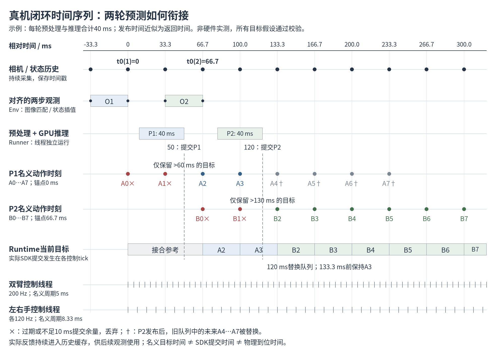
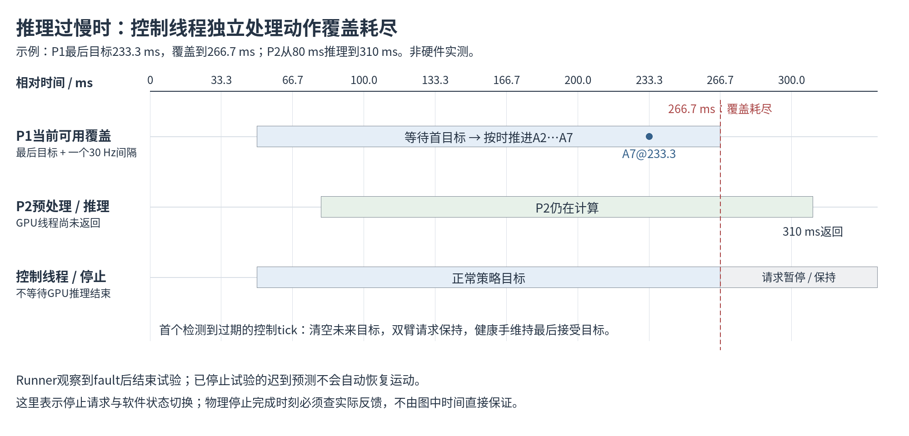

# 真机部署：闭环运行的时间序列

本页图示保留2026-10-08的**历史30 Hz示例**，用于解释 `TianjiRailEnv → TianjiRailRealRunner → TianjiPolicyRuntime` 的队列与过期机制。图中推理耗时均为讲解假设，没有连接设备或测量硬件延迟。

**2026-10-16当前配置已改为10 Hz**：输入查询 `t0−100 ms` 与 `t0`，动作时刻为 `t0+i/10` 秒，8步最后目标为700 ms、覆盖至800 ms；`replanning_steps=1`使重规划锚点最少前进100 ms。下文33.3／66.7／233.3／266.7 ms数值和图片仅属于旧30 Hz示例，不能用来解释新10 Hz模型的当前时间预算。当前流程见[真机评估说明](../real_eval_structure/README.md)。

## 1. 两轮预测怎样衔接



所有横向位置使用同一个主机单调时间轴。为了方便阅读，把第一轮最新观测时刻设为0 ms。图中相机标记表示可查询的30 Hz观测时刻；实际三路图像并非保证同时曝光，低维数据仍需要按时间插值。

### 先确定观测时间，再计算动作

Env 持续保存三路相机和双臂、双手的实际反馈。它选取**四路低维历史均已覆盖的最新主相机时刻**作为 `t0`，查询两步观测 `t0−33.3 ms` 与 `t0`。图像按最近时间匹配，状态按前后测量插值，并检查时效和缺口。

`t0` 是观测锚点，不是“调用模型的此刻”。从观测采集、设备传输、状态覆盖、预处理到推理完成都可能有延迟。因此，推理开始时 `t0` 通常已经在过去。

当前模型生成8步执行段，每一步是52维绝对目标。第i步的名义时刻为：

```text
目标时刻[i] = t0 + i × 1/30 秒，i = 0…7
```

Runtime在实际接收预测时进行筛选，当前配置提交余量为10 ms：

```text
保留条件：目标时刻[i] > Runtime当前时刻 + 10 ms
```

这里是严格大于；落在余量边界上的目标也会丢弃。当前实现不会把第0步改到推理完成时刻，也不会将整个动作序列往后平移。

### 图中的具体例子

示例假设所有目标通过工作空间、跳变、速度和设备健康检查，并把“计算返回”和“队列提交”近似看作同一时刻；实机两者之间还可能有额外开销。

| 事件 | 第一轮P1 | 第二轮P2 |
| --- | --- | --- |
| 最新观测锚点 | 0 ms | 66.7 ms |
| 输入观测时刻 | −33.3、0 ms | 33.3、66.7 ms |
| 预处理与推理 | 10→50 ms，共40 ms | 80→120 ms，共40 ms |
| 原始8步名义时刻 | 0、33.3、66.7、100、133.3、166.7、200、233.3 ms | 66.7、100、133.3、166.7、200、233.3、266.7、300 ms |
| 筛选阈值 | 严格大于60 ms | 严格大于130 ms |
| 丢弃 | A0、A1 | B0、B1 |
| 最早保留目标 | A2，66.7 ms | B2，133.3 ms |

第一轮发布前，以及发布后尚未到66.7 ms时，Runtime保持启动时设定的接合参考。它不会提前将A2作为当前策略目标。到66.7 ms之后的控制tick开始读取A2，到100 ms之后读取A3。

**120 ms发布P2时，旧的未来队列整体替换。** 旧队列中的A4…A7不会继续按原计划执行。由于新的首目标B2尚未到133.3 ms，Runtime在这段间隙保持已选择的A3，到133.3 ms之后的控制tick改为B2。它既没有将P2延后，也没有要求先执行完P1的全部8步。

`Runtime._target()` 按名义时刻选择最近已经到时的目标，是分段保持；双臂执行器再进行受约束伺服，手在实际提交前限速。它不是在Runtime中对两段预测做线性融合。

## 2. 哪些循环同时运行

| 循环 | 当前配置与职责 |
| --- | --- |
| 相机采集 | 三路RGB持续采集，名义30 Hz，时间戳存入历史 |
| 状态历史 | `state_hz=100`采样实际状态并计算FK；这不是设备原始反馈频率 |
| 模型推理 | 独立线程；最新观测锚点至少前进 `replanning_steps/30=66.7 ms` 才启动下一轮计算，实际频率还受数据可用性和推理耗时影响 |
| 双臂控制 | 独立控制线程，名义200 Hz，每5 ms读取当前目标并提交受约束伺服请求 |
| 左右手控制 | 左右手各自线程，名义120 Hz，每8.33 ms读取目标、限速并提交 |
| 事件日志 | 异步记录预测、队列时刻、下发计时和暂停；不保存视频 |

图中的5 ms和8.33 ms刻线表示配置的名义控制周期，并非线程周期实测。达到动作名义时刻后，控制线程在后续实际tick取出该目标；线程调度、SDK互斥、传输和设备响应都会影响实际提交及到位时间。

闭环的反馈来自真实图像、实际机械臂关节FK与实际手关节，持续更新历史缓存，为后续观测提供依据。下一轮观测对应其锚点时刻的状态，不能假定它已包含上一轮所有预测动作的执行结果。

需要区分三个时间：**策略目标的名义时刻、SDK实际接受/提交事件时刻、设备物理到位时刻**。日志能记录前两类事件及反馈，SDK接受不代表已经到位；当前没有已标定的设备延迟补偿。

## 3. 推理过慢或观测失效时



8步预测中的最后目标为 `t0+7/30` 秒。Runtime允许最后目标继续覆盖一个策略间隔，到 `t0+8/30` 秒时判定覆盖耗尽。例如第一轮锚点为0 ms，最后目标为233.3 ms，覆盖上限为266.7 ms。

当新预测不能及时补充覆盖时，控制线程在首个检测到过期的实际tick触发故障，清空未来队列并请求暂停；这不需要等待GPU推理返回。双臂请求保持，健康手维持最后接受的目标。Runner观察到故障后结束试验，停止试验的迟到预测无法重新发布并自动恢复运动。停止请求发出不等于机械运动已经停止，实际完成情况需检查反馈。

另有两种直接中止情形：

- 预测返回时没有任何目标满足“未来＋提交余量”，`future_actions()`拒绝该预测。
- 已经执行策略期间，观测历史缺失或过期、目标校验失败、设备拒绝提交等，推理或控制线程触发暂停处理。

新队列的第一个未来目标尚未到时，可以保持上一当前目标，但不能越过上一段已有覆盖期限无限等待。没有启用未经标定的动作提前量，也不会自动回位重启试验。

## 4. 核心实现位置

| 工作 | 源码 |
| --- | --- |
| 观测锚点与两步对齐 | [tianji_rail_env.py：align_observation](../../../diffusion_policy/real_world/tianji_rail_env.py#L85) |
| 观测预处理、模型调用、观测步进门槛、发布时刻 | [tianji_rail_real_runner.py：_infer](../../../diffusion_policy/env_runner/tianji_rail_real_runner.py#L224) |
| 动作名义时刻和过期筛选 | [tianji_policy_runtime.py：future_actions](../../../diffusion_policy/real_world/tianji_policy_runtime.py#L28) |
| 新预测替换队列 | [tianji_policy_runtime.py：submit](../../../diffusion_policy/real_world/tianji_policy_runtime.py#L103) |
| 选择当前目标、覆盖期限和控制tick | [tianji_policy_runtime.py：_target / tick](../../../diffusion_policy/real_world/tianji_policy_runtime.py#L145) |
| 控制周期与故障暂停 | [tianji_policy_runtime.py：_loop](../../../diffusion_policy/real_world/tianji_policy_runtime.py#L218) |
| 当前频率、提交余量和时效参数 | [tianji_rail_real_eval.yaml](../../../diffusion_policy/config/tianji_rail_real_eval.yaml) |

图源：[两轮闭环Mermaid](06-real-runtime-timeline.mmd)；[PNG时间轴绘图脚本](render_runtime_timing.py)。完整组件结构见[任务流程说明](explanation.md)。
