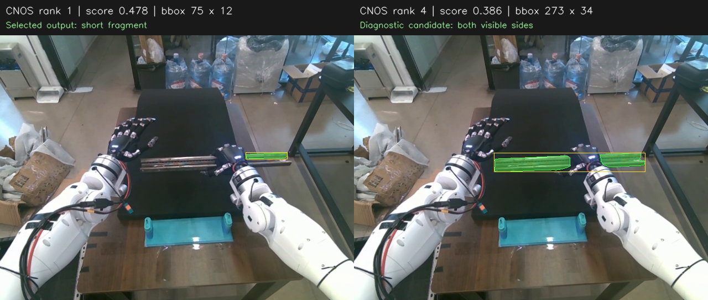
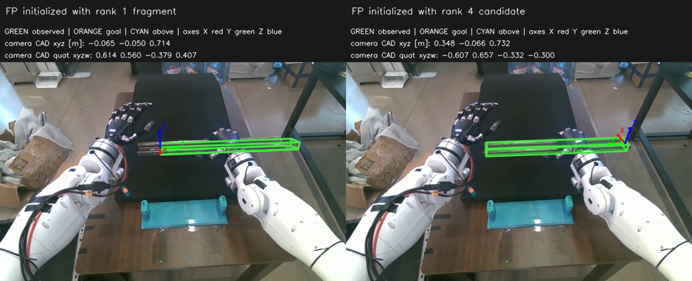

# CNOS 官方流程与检测诊断

日期：2026-10-25。所有验证均为录制数据离线推理或主视相机只读采集，没有连接机器人执行器。

## 本轮结论

已将原先 SAM-B / DINOv2-B 的自行组合适配器替换为 CNOS 官方完整检测流程，并下载 SAM-H、DINOv2-L 权重、安装官方加载器所需依赖。最终仍只向 FoundationPose 传入一个实例的 mask，输出一个位姿。

完整流程在录制的抓持画面上仍选中了导轨短端。该样本的直接问题是候选排名：正确覆盖两侧可见部分的候选已经存在，但得分低于短片段。更换完整官方模型没有消除这一问题，不能将本轮修改描述为检测精度已修复。

## 实现与官方来源

- [CNOS 论文](https://arxiv.org/abs/2307.11067)。
- [官方检测入口 CNOS.test_step](https://github.com/nv-nguyen/cnos/blob/298d1f3366171464ca271659f0e2f7a6eb8e39b4/src/model/detector.py)。
- [官方默认配置](https://github.com/nv-nguyen/cnos/blob/298d1f3366171464ca271659f0e2f7a6eb8e39b4/configs/model/cnos.yaml)。
- [官方 BOPTemplate](https://github.com/nv-nguyen/cnos/blob/298d1f3366171464ca271659f0e2f7a6eb8e39b4/src/dataloader/bop.py)。

本地桥接入口为 `workspace/rail_pose_insert/rail_receive/cnos.py`。直接调用官方 `test_step`，保留 SAM 候选生成、小框和小 mask 过滤、DINOv2 特征提取、Top-5 平均余弦相似度、置信度筛选、最多 100 个实例和按类别 NMS。官方源码不修改；最后才从官方处理后的结果中取最高分的一个 mask，交给 FoundationPose。

配置由上游 Hydra 文件加载，使用 SAM ViT-H、DINOv2 ViT-L/14、描述子输入 224、批量 16、SAM points_per_batch=64、稳定性阈值 0.97、匹配阈值 0.15、最小框相对面积 0.05²、最小 mask 相对面积 3e-4、按类别 NMS 阈值 0.25。

CAD 模板采用官方支持的 Pyrender 路线，42 个视角及文件编号来自官方 BOP 视角索引。使用官方渲染器和 BOPTemplate 的裁剪、缩放、补边、归一化。导轨 CAD 长 0.48 m，渲染半径设为 0.8 m。新模板和描述子使用独立缓存，未混用旧 B 模型描述子。检查旧模板的 42 个视角均未触及图像边界，没有发现此前模板被裁掉的证据。

模型和新增依赖均在 DP 使用的 `tianji-rail-diffusion-policy` 环境中：

| 资源 | 版本或 SHA256 |
|---|---|
| CNOS | `298d1f3366171464ca271659f0e2f7a6eb8e39b4` |
| DINOv2 源码 | `7764ea0f912e53c92e82eb78a2a1631e92725fc8` |
| SAM-H 权重 | `a7bf3b02f3ebf1267aba913ff637d9a2d5c33d3173bb679e46d9f338c26f262e` |
| DINOv2-L 权重 | `d5383ea8f4877b2472eb973e0fd72d557c7da5d3611bd527ceeb1d7162cbf428` |
| BOP Toolkit | `cea62d651c7e395b2e1962b9749e4e89693c6ac4` |
| pypng | `0.20220715.0` |

安装时没有替换现有 Torch、NumPy、CUDA。模型、来源及摘要记录在 `third_party/cnos_manifest.json`；以后迁移可运行 `python workspace/rail_pose_insert/prepare_cnos.py` 下载权重、生成模板，不连接设备。

## 检测不足的复现

数据来自 `/home/yuchen/project/bimanual-teleop/recordings/record_grasp_pose/episode_000001` 的主视相机。使用与实时管线一致的彩色去畸变和 640×480 输入，对两个时刻分别运行旧适配器和完整官方流程。

| 画面 | 旧适配器最高分结果 | 完整官方流程最高分结果 |
|---|---|---|
| B2 后约 28.078 s，导轨遮挡较少 | 0.597，框 297×41 px | 0.552，框 295×41 px |
| 抓稳约 37.718 s，右手遮挡中部 | 0.587，框 75×12 px，仅右端 | 0.478，框 75×12 px，仍仅右端 |

第二幅图中，完整官方流程经阈值和 NMS 后保留 45 个内部候选；最终仍只输出最高分的一个。覆盖导轨两侧可见部分、排除中间遮挡手部的候选存在，框为 273×34 px、分数 0.386，排第 4；第 2、3 名还出现了桌边等条状背景。



这证明该帧不是完全没有生成合适的 SAM 候选。根据官方匹配代码，最终排序仅依据候选特征与 CAD 模板特征的相似度，没有“必须覆盖整根导轨”或“必须由右手握持”的约束。结合图像，推断抓握遮挡使两侧分离的目标外观与完整 CAD 模板差异增大，短端反而得分更高。CAD 无真实金属纹理、实物高反光也可能增加外观差异，但本轮没有独立实验量化它们的贡献。

另外，在不动作的主视相机联调中，导轨置于桌面、右手没有握住导轨，两次全图识别的最高分分别为 0.433 和 0.474，选中的是画面底部桌沿，而非图中实际导轨。这再次复现条状背景混淆；因此问题不只来自手部遮挡。该结果也说明 FoundationPose 返回 `valid: true` 仅表示计算得到一个位姿，不表示 CNOS 已选中正确物体。

单纯调阈值不能改变候选顺序：提高到 0.386 以上会先排除两侧可见候选，提高到 0.478 以上则该图最高分也被排除。降低阈值不会把第 4 名提升为第 1 名。增加最终输出实例数同样不符合本任务要求。

## 对 FoundationPose 的影响

对同一帧 RGB-D，分别使用第 1 名短片段和第 4 名两侧可见候选，独立调用 FoundationPose 初始化。彩色帧和深度帧时间差约 -0.0148 ms；使用录制相机内参、深度尺度、深度到彩色外参配准，保持其余输入相同。

| 输入 mask | mask 像素数 | 有效深度像素数 | 图像观察 |
|---|---:|---:|---|
| 第 1 名短片段 | 700 | 502 | CAD 投影相对实物明显偏移 |
| 第 4 名两侧可见部分 | 5105 | 4491 | CAD 投影更贴近实物两端 |



两次初始化的 CAD 原点不同，长轴朝向也有翻转，不能直接把平移分量相减当成位姿误差。本轮没有真值位姿，只能进行叠图的定性比较，不能据此认定插入精度合格。数值结果见同目录 `2026-10-25-CNOS检测诊断数据.json`。

本轮保留官方相似度排名，没有硬编码选择第 4 名，也没有合并多个 mask。后续若要稳定区分“右手握持的整根导轨”，优先在官方输出后增加基于握持位置与 CAD 几何的一实例选择验证，而不是继续盲调相似度阈值；这属于额外的任务约束，不应称作 CNOS 原始算法本身。

## 时序、界面和联调

启动命令不变：

```bash
conda activate tianji-rail-diffusion-policy
python /home/yuchen/project/diffusion_policy/workspace/rail_pose_insert/receive.py
```

设备初始化并张手完成 → 等 5 秒开始抓握 → 手指稳定后再等 5 秒 → 全图 CNOS 新 mask → FoundationPose。T 再走一次全图分割、匹配和位姿初始化。实时画面、最后一次估姿叠图、右臂点动、G 直接闭合保持现有行为。

联调发现 RGB-only 切换到 RGB-D 后，偶发第一组彩色与深度帧相差超过 5 ms，原处理会直接结束本次估姿；随后独立采样的 45 组时间差均小于 5 ms。已改为在原有 2 秒取帧超时内丢弃不同步帧、继续读取，仍不把超过 5 ms 的帧对交给模型。新增测试覆盖一次不同步后恢复，以及持续不同步时仍拒绝。

验证结果：

- 87 项相关测试通过，覆盖定时抓握、键盘控制、阶段隔离、重复重新识别、窗口叠图、搬运入口和官方过滤/匹配/NMS 后最终只输出一个实例。没有执行真机动作。
- 真实主视相机完成连续两轮“全图 CNOS → 释放 CNOS 显存 → FoundationPose → 保存位姿叠图”，第二轮通过与 T 相同的重新初始化请求触发，耗时分别约 44.84 s、53.86 s。两轮均最终输出一个实例。
- 两轮完成后相机预览继续更新，位姿记录保持不变，确认空闲阶段没有重复推理。第二轮能够在 FoundationPose 加载后的进程中重新构建 CNOS；未遇到显存不足或默认 Torch 设备导致的重载错误。
- 当前显卡为 RTX 3070 Ti Laptop 8 GB；录制画面上的完整 CNOS 检测阶段约 9～21 s、峰值 PyTorch 预留显存约 7.46 GB。耗时随候选数量、模型加载和场景而变。
- 对照 GitHub 固定提交，检测器、DINOv2、SAM、后处理、BOPTemplate、Pyrender、视角工具、裁剪工具及 3 个配置文件，共 11 个关键上游文件逐字节一致。
- Python 语法编译和 `git diff --check` 通过。
- `python workspace/rail_pose_insert/check.py` 通过：右手配置 `ready: true`，左臂预插入配置 `ready_for_live_configuration: true`，两者 `problems` 均为空；此检查不连接执行器。

以上证明流程、单实例输出和重复识别能够运行；录制数据与实时画面上的错误候选仍存在，尚未通过检测准确率或插入位姿精度验收。
