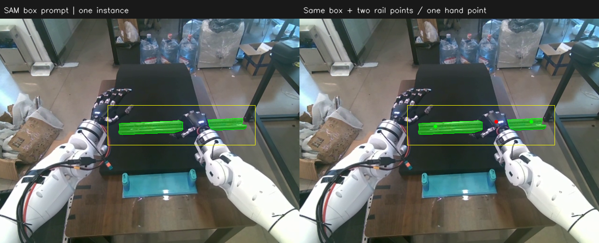

# SAM 框提示分割与抓后估姿

本轮将右手接料的默认视觉链路改为“用户框/可选正负点 → 本地 SAM ViT-H 单实例 mask → FoundationPose”。当前时序为准备好后等待 5 秒抓握、手指稳定后等待 8 秒估姿；保留 G 提前闭合、终端 T 重新估姿、右臂键盘点动及持续相机窗口。运行时不调用 GPT，也不运行 CNOS 的全图候选生成、DINOv2/CAD 匹配及候选排名。

## 提示与分割

`receive.yaml` 的 `sam_prompt` 指向用户自己的 `sam_prompt.json`，加载配置时按 YAML 所在目录解析为绝对路径。仓库不预填用户的框和点。JSON 包含：

- `image_size`：主视相机的 `[640, 480]`；坐标基于已去畸变的 RGB 图像，不含窗口标题或底部状态栏。
- `camera_serial`：主视相机序列号，运行时与当前相机核对。
- `box_xyxy`：用户拖出的稍宽松导轨范围框。
- `point_coords`、`point_labels`：可选点，标签 1 是导轨正点，0 是手部或其他背景负点。两者可为空；不自动在框中心补正点。

SAM 使用官方 `SamPredictor`，调用 `predict(box=..., point_coords=..., point_labels=..., multimask_output=False)`。图像编码读取完整 RGB，使用框/点约束分割；最终仅保留框内的 mask。框外像素清空，框内属于同一实例的可见部分全部保留，不因中部被手遮挡而只取最大连通区域。单次仅输出一个 mask，随后交给 FoundationPose 初始化。

框应覆盖导轨两侧所有可见部分，尽量避开桌沿等条状背景。先测试纯框，效果不足再补导轨两侧的正点和可见手部的负点。提示是固定像素坐标，不随机械臂移动；点动或导轨变化后应检查并修改，避免旧正点落在背景上。

## 运行与修改提示

激活现有环境，均在项目根目录执行：

```bash
conda activate tianji-rail-diffusion-policy
python workspace/rail_pose_insert/set_sam_prompt.py
```

独立设置脚本只打开主视相机，不连接机器人。空格冻结当前帧，左键拖框；框选后可以直接 Enter 保存，也可左键加正点、右键加负点。Z 撤销最后一点、C 清点、B 重画框；空格重拍并清空全部提示；Q/Esc 取消且不覆盖已有文件。完成后运行：

```bash
python workspace/rail_pose_insert/receive.py
```

主窗口 E：窗口有焦点时冻结当前相机画面，清空编辑态旧框和旧点，直接拖绘新的 bbox；不重新打开或抢占相机流。可选添加正负点，B 重画框、C 清点、Z 撤销，Enter 保存并自动请求重新 SAM 分割与 FoundationPose 初始化，无需另按 T。E 取消时不保存、不重估。E 只冻结编辑画面，不暂停抓握倒计时或正在运行的估姿。动作窗口内 Q/空格仍暂停、X 仍退出；Esc 取消编辑并暂停。抓前保存供首次估姿使用；抓后首次 8 秒等待期间保存也不会提前启动推理，仍在倒计时结束时使用最新提示。T 保留为直接按已有保存提示重新估姿的入口。

没有提示文件、提示无效或 mask 为空时，仅本轮视觉任务失败，相机窗口和 G、点动继续可用。可在主窗口 E 设置提示、Enter 保存后自动重试，不必退出接料进程。接料正在使用相机时，不另开独立设置脚本。独立设置脚本只保存提示，仍不触发机器人或估姿。

## 可视化与模型切换

左侧实时相机叠加黄色提示框、绿色正点及红色负点。分割完成后，右侧先显示对应 RGB 帧上的 `LAST SAM MASK` 快照；FoundationPose 初始化完成后替换为 `LAST POSE SNAPSHOT (NOT LIVE)`，显示 CAD 投影、三维包围框、坐标轴、相机系位置和四元数。快照不会随点动伪装成实时位姿。

SAM 加载、分割完成后释放模型显存，再加载 FoundationPose。每次 T 都重新读取提示并分割新图像，不沿用旧 mask。空闲阶段只刷新相机，不持续推理。抓握时序和手型参数未因本轮视觉修改而改变。

控制和感知继续共用 `tianji-rail-diffusion-policy`。SAM-H 复用已有文件 `third_party/cnos/pretrained/segment-anything/sam_vit_h_4b8939.pth`；不需要为了默认接料下载 DINOv2 或生成 CAD 模板。CAD 模型仍用于 FoundationPose。旧 `view_detection.py` 继续作为独立 CNOS 诊断入口，不参与默认接料链路；历史 [CNOS 检测诊断](2026-10-25-CNOS官方流程与检测诊断.md) 保留。

## 离线样本结果与验证边界

对同一录制抓持帧 `held_tail` 测试了一个仅用于诊断的框 `[230, 185, 545, 270]`：

| 提示方式 | mask 像素数 | SAM 预测 IoU |
|---|---:|---:|
| 仅框 | 5208 | 0.954939 |
| 同框加正负点 | 5154 | 0.968414 |

纯框已覆盖被手遮挡导轨两侧的可见部分，避免此前 CNOS 最高分仅覆盖右侧短端的问题。加点样本的预测 IoU 较高，不等于有真值测得的精度提升。上述坐标没有写入用户默认提示，SAM 预测 IoU 也不是“识别到导轨的概率”，不用于额外自定义阈值筛选。



另测了覆盖整张桌面和部分地面的框 `[156, 27, 640, 416]`：仅框时主要分出背景（32751 像素），尽管 SAM 预测 IoU 为 0.975；加相同正负点后包含导轨两侧，但仍混入背景碎片（11898 像素）。因此框可以留余量，但不能把整张桌面当作无歧义的目标框，正负点也不能保证弥补过宽的范围。此结果再次说明预测 IoU 不能代替目标正确性检查。

验证结果：

- 107 项相关测试通过，覆盖提示校验、官方 SAM 单 mask 参数、两侧不连通区域保留、编辑器与主窗口 E 交互、缺少提示后的恢复、重复 T、连续跟踪模式重新初始化，以及既有抓握时序、点动和搬运入口。
- 最后调整连续跟踪失败后的模型释放顺序后，14 项相机/worker 回归测试再次通过；异常 traceback 清除后才在下一轮加载 SAM，避免旧 FoundationPose 被异常引用保留时同时加载新模型。
- 在真实 OpenCV 原生窗口验证了预览 → E 冻结 → 鼠标拖框 → Enter 保存；坐标与加载后的 JSON 一致。只使用临时提示文件，未代替用户设置默认框和点。带该临时有效提示的依赖/配置预检通过。
- 真实主视相机仅采集了彩色帧，未连接机器人。当前相机画面没有导轨，因此完整模型链使用上述录制的同一帧真实 RGB-D 离线验证。
- 调用生产 worker 的两轮完整 SAM → 释放显存 → FoundationPose → 单帧跟踪 → 保存 mask/位姿快照，分别约 22.42 s、28.21 s；第 1 轮仅框，第 2 轮在修改提示文件后重新初始化，确认读取了新正负点。两轮最终各一个 mask、一个位姿。完成后预览继续刷新，推理记录保持不变，未持续运行模型。
- 仅 SAM 的首次模型加载约 5.50 s；同帧分割约 1.25～2.39 s，峰值 PyTorch 预留显存约 6262 MiB（6.12 GiB），测试显卡为 RTX 3070 Ti Laptop 8 GB。完整链路耗时还包括 FoundationPose 的加载和初始化。
- Python 语法编译与 `git diff --check` 通过。

数值记录见同目录 `2026-10-25-SAM框提示验证数据.json`，位姿叠图见 `2026-10-25-SAM框提示位姿叠图.png`。未进行机器人动作验收，也未取得当前抓握姿态的位姿真值。单个录制样本改善不能保证其他姿态的分割或 FoundationPose 绝对位姿精度。

## 时序与重新画框更新

当前默认配置为接料准备好后等待 5 秒开始抓握，抓握完成并稳定后再等待 8 秒，读取保存的 bbox，经 SAM 单 mask 初始化 FoundationPose。主窗口 E 直接从冻结的当前画面重新拖框；Enter 保存成功后发出 `prompt_saved` 事件，由控制主循环走同一重新分割/估姿入口。保存发生在首次 8 秒等待期间时，保持原截止时间，不提前推理；保存发生在第一次估姿完成后时，自动重新分割与估姿，不再抓握。

更新后 109 项相关测试通过，包括新框保存事件、旧框与旧点清空、保存后自动重新估姿且不重抓、等待期间保存不跳过倒计时。Python 语法编译和 `git diff --check` 通过，本次未执行机器人动作。
