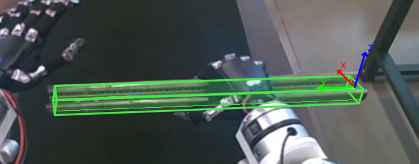

# 仅显示调整后的导轨位姿

当前右手感知链路先按已示教目标进行首尾对齐，要求相对目标固定 XYZ 的旋转分量分别小于 45°。只有通过约束的结果才发布位姿并绘图；缺少匹配目标或角度仍越界时提示对齐失败、保持相机画面，不绘制原始估计或越界候选。

图像只显示调整后的绿色 CAD 轮廓、包围框与红 X、绿 Y、蓝 Z 轴。原始位姿不绘制，目标及目标上方参考框也不再叠加；它们仍参与计算。静态快照不叠加大块文字，数值面板单独显示相对目标 XYZ 角度。成功输出仍保留原始矩阵，方便诊断，控制计算使用调整后矩阵。

## 示例来源与结果

使用已有 SAM 离线验证的第 2 次估计，对应录制 RGB 帧 `00001512`；原始帧及相机内参来自 `/tmp/sam-prompt-offline-scene`，位姿来自 `plan/2026-10-25-SAM框提示验证数据.json`，参考目标为 `workspace/rail_pose_insert/targets/rail_goal.json`。没有使用截图猜测相机内参或三维姿态。

相对目标 XYZ 分量为 `[1.1548, 9.1297, 4.8306]°`，全部小于 30°。这一录制样本原本已处于正确分支，因此选择恒等候选，保留实际估计，不额外伪造一次翻转或把朝向贴到目标上。图像是约束对齐后的输出，不是新采集的当前现场帧。

[完整图像](2026-10-25-导轨调整后位姿-全图.png) · [位姿、相机内参及裁剪参数](2026-10-25-导轨调整后位姿.json)

局部展示由原始 RGB 裁剪并放大 2 倍，投影时同步调整相机内参；只投影一组通过约束的位姿。没有在含旧坐标轴的截图上覆盖新坐标轴。

## 验证

57 项相关测试通过，涵盖位姿对齐、显示与发布结果一致、越界/缺少参考时不画原始位姿、单次/连续估姿、快照与图像帧配对及原搬运路径。CAD 叠图已目视检查；`git diff --check` 通过。本轮未调用 GPU 推理、相机或机器人。

现有进程不会热加载代码，需在下次启动时生效。
