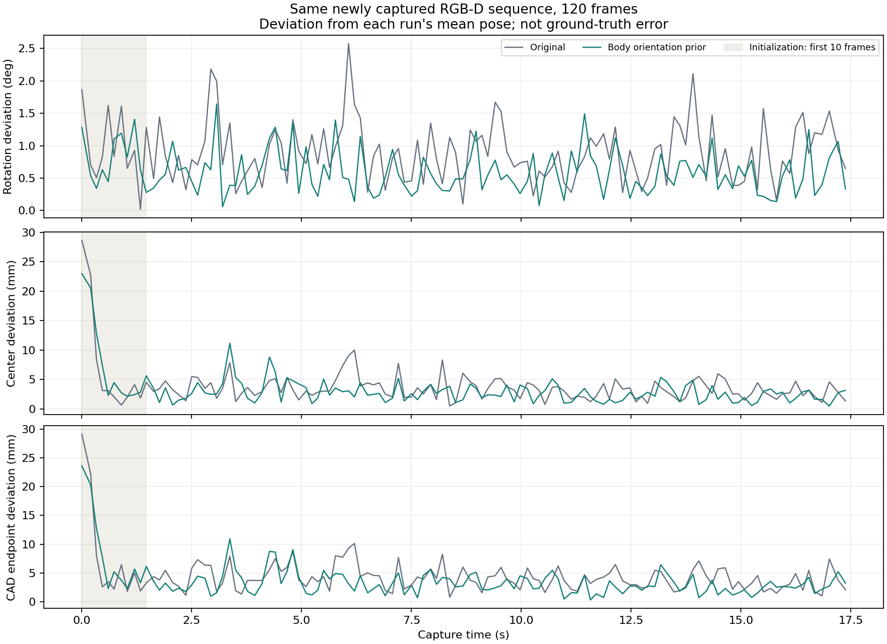

# 整机方向先验与位姿抖动验证

用户先验：导轨凹面（480×45 mm）近似水平向上；480×25 mm 两侧面朝机器人前后，因此长轴沿整机左右。以机器人 `base_link` 为准，不使用单臂 SDK 基座或模拟世界轴代替。

1. 从已验证的 SDK/URDF 变换和实测相机标定求相机到整机变换；核验 CAD +Z 对应凹面向上、CAD ±X 对应前后、CAD ±Y 对应左右。
2. 将先验用于 FoundationPose 初始旋转候选及迭代细化；保留视觉平移和小幅角度偏离，不把输出直接设置为目标姿态。保持原始 CAD/居中网格变换一致，记录先验修正及失败原因。
3. 相同 RGB-D 帧、mask、迭代次数下对照原流程与先验流程，分别统计角度、中心与端部位置抖动，以及图像/深度吻合程度。静态抖动下降不等于绝对精度提高。
4. 单元及集成回归；验证仅使用离线记录或只读相机，不启用机器人执行器。

## 实现完成

- 新模块：`workspace/rail_pose_insert/rail_preinsert/body_orientation_prior.py`；接入 `receive_perception_worker.pose_engine`，覆盖右手抓后单次估姿、连续跟踪和两个搬运入口。`receive.py check` 在启动设备前验证先验的标定与坐标变换。
- 配置：`receive.yaml` 的 `body_orientation_prior` 默认启用。倾斜候选范围 15°、水平朝向范围 30°、采样步长 10°；共 182 个候选，保留两个首尾分支。视觉细化后向理想方向缩减 25% 的旋转偏差、每次最多修正 5°。参数是本次实验设置，不是用户给出的精确角度。
- 原始视觉结果若凹面倾斜超过 30° 或长轴水平朝向偏差超过 45°，拒绝候选，不通过强行修正掩盖错误。候选修正后由 FoundationPose 评分；跟踪状态与输出保持一致。
- 旋转围绕 CAD 包围盒中心修正，原始 CAD 原点位于端部，因此输出端部平移会随旋转按刚体关系补偿。每次修正保留视觉中心；迭代反馈仍可能改变后续视觉平移，不能声称两组中心位置完全一致。
- `T_C_CAD_before_body_prior` 是同一先验跟踪历史下的当前视觉细化值，不是独立基线；真正基线通过单独进程重新回放取得。连续成功/失败记录写入运行目录的 `perception/<generation>/pose_records.jsonl`。沿用默认临时目录的清理策略，需用 `--output` 才在退出后保留。
- 上游 FoundationPose 源码及其摘要未修改。目标示教和左臂预插入不启用本次软约束。原有首尾对齐、5 mm / 0.035 rad 多帧一致性门限及运动检查不变。

整机变换由实测 `T_leftSDK_camera` 和经过非零关节 FK 验证的 URDF 配准计算：

```text
T_body_camera = inverse(T_simWorld_body) @ inverse(T_leftSDK_simWorld) @ T_leftSDK_camera
```

本机旋转部分为：

```text
[-0.999983  -0.003737   0.004487]
[-0.005759   0.758116  -0.652094]
[-0.000965  -0.652109  -0.758125]
```

## 使用用户调整后重新拍摄的数据

用户说明导轨位置已调整后，重新采集了 120 帧、17.377 秒的 D436 RGB-D，序列号 `405622076394`。旧目录 `outputs/body_prior_20261025` 的数据不参与以下结论。新数据在 `workspace/rail_pose_insert/outputs/body_prior_20261025_recapture/scene`。

按新图像单独生成 SAM 验证掩码：框 `[207,220,415,250]`，正点 `[300,235]`，掩码 2476 像素。没有覆盖正式运行的 `sam_prompt.json`。两端部分被机械臂遮挡；桌面上的导轨保持静置。第 10 帧起的 68 个轨上角点相对第 10 帧的中位光流位移，跨帧 P95 为 0.139 像素、最大 0.150 像素，支持将其作为静态测试，仍不是独立物理真值。

三组使用同一 RGB、深度、内参、时间戳和初始 mask，随机种子 0；初始化 5 次细化、跟踪 2 次细化、batch 8。输入摘要 `1c24a3204181007dacb6bd3ba2f7812a78567f58971d29807806b7ffd283e273`。`grid_only` 的修正权重为 0，仍保留方向候选与矛盾姿态拒绝检查；不做逐帧软修正。三组均成功输出 120/120 帧，无重初始化失败。预先采用前 10 帧作为初始化过渡段，稳态统计使用后 110 帧；完整 120 帧统计也保存在报告中。

| 后 110 帧指标 | 原流程 | 方向候选/检查，不软修正 | 初始化＋逐帧软约束 |
|---|---:|---:|---:|
| 朝向相对本组均值 RMS | 1.006° | 0.948° | **0.664°** |
| 导轨中心相对本组均值 RMS | 3.850 mm | 3.533 mm | **3.247 mm** |
| CAD 端部相对本组均值 RMS | 4.560 mm | 4.347 mm | **3.667 mm** |
| 相邻帧朝向变化 RMS | 1.116° | 1.128° | 0.917° |
| 相邻帧端部变化 RMS | 5.731 mm | 5.729 mm | 4.895 mm |
| 3 帧一致性通过窗口 | 81/108（75.0%） | 90/108（83.3%） | **94/108（87.0%）** |
| 可见 mask 被渲染模型覆盖比例 | 99.73% | 99.44% | 99.51% |
| 深度绝对残差中位数的采样均值 | 14.751 mm | 13.573 mm | 14.318 mm |
| 深度绝对残差 P90 的采样均值 | 30.398 mm | 28.895 mm | 27.209 mm |

完整软约束相对原流程：角度 RMS 减少 **34.0%**，中心 RMS 减少 **15.7%**，端部 RMS 减少 **19.6%**。若不去掉初始化，120 帧角度 RMS 为 1.012°→0.686°，端部 RMS 为 5.603→4.770 mm，同样有下降。



## 不能据此断言的问题

1. **初始化仍未稳定。** 最初 3 帧端部相对组均值的最大偏差为原流程 11.74 mm、软约束 6.15 mm，仍高于 5 mm 门限。 两组前 3 帧，以及从第 1、2 帧开始的最早几个 3 帧窗口，均未通过现有一致性检查。稳态软约束也仍有 14/108 个窗口失败。本次未改变立即采样/失败暂停的控制逻辑，不能保证原来的“未开始搬运”已经解决。
2. **平均姿态发生偏移。** 完整软约束与原流程平均中心相差 3.55 mm、平均朝向相差 5.45°。相对整机的凹面平均倾角约由 14.89° 变为 9.49°，朝向更符合先验；这不是独立精度证明。单次修正平均 3.20°、最大 3.65°，没有触及 5° 上限；跟踪反馈可使最终组间偏移大于单次修正量。
3. **深度指标仍有厘米级残差。** 渲染检查每 10 帧一次并包含末帧，稳态共 12 个采样帧；只比较可见 mask、有效深度和渲染深度的交集。该指标会受掩码、遮挡及深度质量影响，既不是完整 IoU，也不是位姿真值。完整软约束的残差中位数略差于“方向候选/检查、不软修正”组，不能只报告较有利的一项。
4. **现场条件范围有限。** 本次结论来自一段重新拍摄的静态导轨数据，没有运动跟踪、抓持扰动、实际搬运或插入精度验收。本轮只访问相机，未连接执行器。

## 验证与复现

新增 14 项测试覆盖整机/相机轴区别、两首尾分支、旋转候选范围、居中网格与原始 CAD 的补偿、软约束和修正上限、矛盾姿态拒绝、评分排除、注册/跟踪状态一致、缺失细化拒绝、实际标定、关闭先验、工厂接入、启动前检查及抖动统计。实验目录除 `test_standalone.py` 外的 **182 项测试通过**；独立搬迁测试组未重跑（本次之前已存在 editable-install 路径隔离问题）。`receive.py check --move-above` 返回 `ready: true`、问题列表为空；Python 语法和 `git diff --check` 通过。

在项目根目录、已激活 `tianji-rail-diffusion-policy` 时，用新的输出目录复现；下列命令只读取已有数据，不控制设备：

```bash
python workspace/rail_pose_insert/tools/validate_body_prior.py replay \
  --variant baseline \
  --scene workspace/rail_pose_insert/outputs/body_prior_20261025_recapture/scene \
  --mask workspace/rail_pose_insert/outputs/body_prior_20261025_recapture/initial_mask.png \
  --output /tmp/rail-body-baseline

python workspace/rail_pose_insert/tools/validate_body_prior.py replay \
  --variant prior \
  --scene workspace/rail_pose_insert/outputs/body_prior_20261025_recapture/scene \
  --mask workspace/rail_pose_insert/outputs/body_prior_20261025_recapture/initial_mask.png \
  --output /tmp/rail-body-prior

python workspace/rail_pose_insert/tools/validate_body_prior.py summarize \
  --runs /tmp/rail-body-baseline /tmp/rail-body-prior \
  --output /tmp/rail-body-comparison.json
```

原始数据、每帧估计、叠图、完整指标与测试日志均保存在本地 [本轮输出目录](../workspace/rail_pose_insert/outputs/body_prior_20261025_recapture/)，其中 [comparison.json](../workspace/rail_pose_insert/outputs/body_prior_20261025_recapture/comparison.json) 是可复核的汇总。输出目录受现有 `.gitignore` 忽略，新机器需另行复制。

## 后续：按用户要求调大一致性阈值

将右手抓持后及到位复核的多帧位置一致性阈值从 5 mm 调至 **10 mm**，配置为 `receive.yaml` → `move_above.pose_consistency_position_tolerance_m: 0.010`。角度一致性门限仍为 0.035 rad；最终到位视觉误差容差仍为 5 mm / 0.035 rad。上文对照表保留原 5 mm 门限的历史结果。

直接复核本轮重新拍摄、已加入先验的 120 帧估计：最初 3 帧最大位置偏差 6.147 mm，现在通过；全部 118/118 个连续 3 帧窗口通过，去掉前 10 帧后为 108/108。数据见 [threshold_10mm.json](../workspace/rail_pose_insert/outputs/body_prior_20261025_recapture/threshold_10mm.json)。这是放宽接纳门限后的结果，没有重新估姿，也不表示测量精度进一步提高。没有执行机械臂动作。
