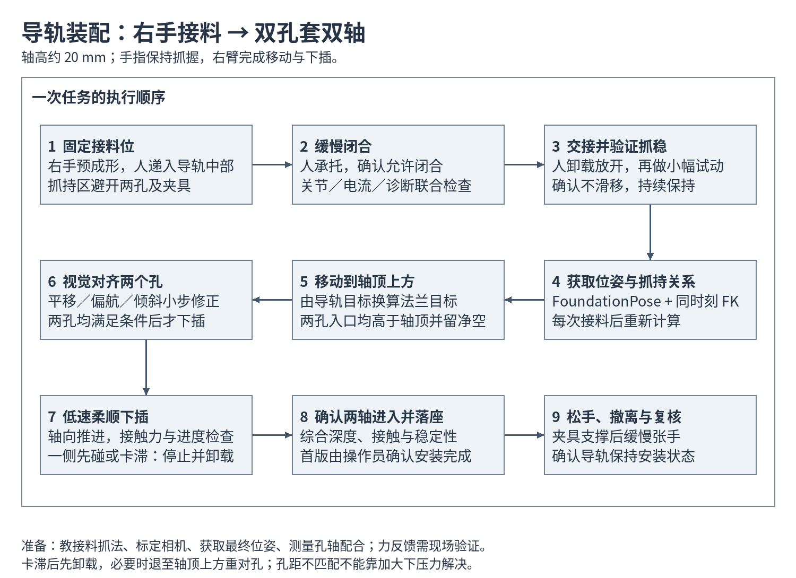

# 右手接料、FoundationPose 定位与导轨双孔套双轴方案

更新日期：2026-10-21。

状态：流程设计，已核对本项目相关接口；尚未实现或连接设备验证。

## 1. 已确认任务与优先方案

- 人把导轨递到机器人右手，右手抓住导轨中部。
- 目标结构为导轨上的两个孔套入两个轴，运动方向从上向下，轴高约 20 mm。
- 导轨最终安装位姿事先通过 FoundationPose 获取。
- 优先使用右臂带动抓持的导轨平移、旋转，手指维持抓握。第一版不增加手内倒换或复杂指尖操作。

建议流程：**固定接料位 → 人递料 → 缓慢闭合 → 确认抓稳并交接 → 估计抓持关系 → 移动到轴顶上方 → 两孔对齐 → 柔顺下插 → 确认安装完成 → 松手撤离。**

人递料使第一版不必解决桌面自主抓取，可以先把稳定抓持、视觉坐标和装配控制分别验证。此流程可作为现有 Diffusion Policy 实验的几何控制基线，不需要先训练新策略。



以下条件尚待现场确认，不能先填成固定控制参数：孔径、轴径、孔距及公差、倒角、孔壁有效导向长度、两个轴的平行度、夹具支撑面、导轨质量和质心、内外轨是否会相对滑动、右臂六维力信号是否可用。

## 2. 怎样先把导轨抓住

### 2.1 先选一个能完成下插的中部抓法

优先在中部选择刚性较好、接近质心的截面，由拇指和对侧的两至四指形成对向包络，尽量靠近掌部形成多个接触点。具体手腕朝向和参与手指由实际截面、安装空间确定。

双孔套轴对抓法有额外约束：

1. 抓持区与两个孔错开，手指不能挡住孔口或轴的上升通道。
2. 导轨下降约一个轴高的过程中，掌部、指尖、手腕不能先碰到轴、夹具或支撑面。
3. 导轨安装后仍要有松手、张指和撤手的空间。
4. 目标抓持关系对应的右臂姿态必须可达，整段运动要考虑长导轨两端的扫掠空间。

可先试侧上方接近中部的抓法。若从下方托握会使手掌在导轨落座前碰到夹具，就更换抓持方向或为夹具留出空间。不能仅凭“中间最稳”就确定抓法。

如果内外轨会滑动，应优先临时固定其相对位置，或明确抓住、追踪并安装的是同一刚体。两个孔若属于不同可动部件，仅有一个刚体位姿不足以定义任务。

### 2.2 用遥操作教一个接料和闭合动作

利用已有手套和机械臂遥操作，教一个可重复的右手接料姿态；第一版不需要自动生成 20 个手指关节角。保存：

| 项目 | 用途 |
| --- | --- |
| 右臂接料位姿和实测关节 | 每次以同一姿态等待人递料 |
| 张手／预成形关节 `q_open`、`q_pre` | 留出导轨进入空间，形成预期包络 |
| 缓慢闭合轨迹 | 控制接触顺序，避免整体关节目标阶跃 |
| 抓稳时实际关节和已接受的指令关节 | 记录接触后的形状与保持预载 |
| 关节电流及诊断 | 建立空载、接触和抓持的反馈基线 |
| 导轨相对法兰的位姿 | 检查这种抓法能否完成双孔套轴 |

先重复少量人工接料，确认哪些手指形成稳定接触，以及允许的递料位置和方向偏差。可在导轨中部标出递料区，让人的摆放更一致。

只保存“抓稳时实测角度”然后直接当作位置目标，可能消掉保持预载。应同时记录命令和反馈，按实测接触结果形成有限预载；不能任意加大闭合角、刚度或电流。

### 2.3 每次接料的执行顺序

1. 右臂停在接料位，手指进入预成形；此时机械臂不追随视觉位姿移动。
2. 人把导轨中部送入手中并继续承托；人的手位于闭合区外，避免把手指伸入机器人手与导轨之间。
3. 操作员给出“允许闭合”信号，机器人缓慢闭合。信号可以先用现有终端按键实现。
4. 联合检查多个接触关节的角度、速度、电流和诊断，判断是否形成预期的对向接触。单一电流升高也可能是关节限位或碰到错误位置，不能直接判为抓稳。
5. 反馈满足初步抓持条件后，人逐步卸载、放开导轨，再给出“已交接”信号。交接完成前不进入搬运状态。
6. 人离开运动范围后，执行有承接条件的小幅试动，例如数毫米平移；用视觉检查导轨相对手是否明显滑移。具体距离由现场空间决定。
7. 试动后稳定，进入持续抓持。抓稳后的手指反馈不必等于空载闭合目标。

Hand2 的 `effort` 是电流，单位 A，不是接触力或关节力矩。接触阈值需扣除动作本身产生的电流，并通过空载与实际抓持标定。现有 `hand_settle.py` 的到位判据是关节误差，适合摆手，不能直接当作带物抓稳判据。

## 3. FoundationPose 与坐标准备

### 3.1 视觉输入

第一版优先使用一个视野稳定的 RGB-D 相机，兼顾导轨中部抓持后的可见区域和两孔／两轴区域。若主相机固定于场地，标定相机到右臂基座的外参；若相机随臂运动，需要手眼标定，并按曝光时刻的右臂实测状态计算相机位姿。

采用 FoundationPose 官方 CAD 路径时，需要同一导轨网格、RGB、深度、相机内参以及初始化物体 mask。首版可以人工给初始 mask；定位成功后进入跟踪。递料后、闭合前遮挡较少时可先初始化，抓稳后重新读取位姿作为当前状态。

必须补齐：

- RGB 与深度按同一投影坐标对齐，并正确处理畸变。
- 原始深度依据 `depth_scale` 转换为米；网格尺寸也统一为米。
- resize、裁剪或旋转图像时同步处理内参及深度。不要直接使用策略预处理后的图像。
- 位姿带原始图像时间戳；建立抓持关系时，插值到同一时刻的机械臂实测状态。
- 保存模型版本、网格坐标定义及标定版本。官方 demo 用于画框的中心化坐标不应与网格位姿混用。

针对金属导轨、细长几何和抓握遮挡，先测静止抖动、有效深度比例、模型轮廓／深度一致性与端部特征方向。连续性检查要防止头尾翻转，但不能掩盖长期估计错误。FoundationPose 返回一个矩阵不代表该帧可靠；质量检查需要集成层实现。

### 3.2 最终目标怎样保存

将导轨正确安装到两轴上，在相机可观测条件下采集多帧，核查网格与两个孔的对应关系，再保存最终位姿。旋转采用 SO(3) 上的平均方法，不直接平均欧拉角。

目标应保存于右臂基座坐标系，或更推荐保存于夹具坐标系。夹具一旦移动，要重定位夹具，更新目标；只保存历史相机坐标中的导轨矩阵，不能自动适应相机或夹具位置变化。

建议同时保存两个轴的中心、顶部高度、轴线方向和安装支撑面，或相应的夹具坐标。最终导轨位姿定义终点，两轴几何定义进入终点的通道。

## 4. 从导轨位姿计算机械臂目标

约定 `ᴀTʙ` 把 B 系中的点变换到 A 系；`B` 为右臂基座，`C` 为相机光学系，`F` 为右臂法兰，`O` 为被抓持的导轨刚体系。

固定相机下：

```text
ᴮTᴼ(t) = ᴮTᶜ · ᶜTᴼ(t)
```

抓稳、交接完成后，以同一时刻的实测法兰位姿和视觉位姿建立抓持关系：

```text
ᶠTᴼ = inverse(ᴮTᶠ(t)) · ᴮTᴼ(t)
```

在抓持关系稳定时，导轨期望位姿 `ᴮTᴼ_goal` 对应的法兰目标为：

```text
ᴮTᶠ_goal = ᴮTᴼ_goal · inverse(ᶠTᴼ)
```

等价地，当前到目标的刚体变换可写成：

```text
Delta_B = ᴮTᴼ_goal · inverse(ᴮTᴼ_current)
ᴮTᶠ_goal = Delta_B · ᴮTᶠ_current
```

上式需要当前物体和法兰观测时间对齐，且导轨没有相对手滑移。不能把三维位置差和欧拉角差直接逐项加到手臂命令上。

每次人递料的位置会稍有不同，因此每次抓稳后都更新 `ᶠTᴼ`；不能一直沿用第一次示教的绝对机械臂姿态。搬运过程中监测该关系是否漂移，接触装配时同时考虑视觉误差和弹性形变。

本项目低层接口控制的是右臂基座系下的法兰位姿，帧名为 `tianji_right_base → tianji_right_flange`。如果上层使用手掌系，还需显式换算法兰到手掌的安装变换。

## 5. 双孔套双轴的装配流程

### 5.1 先检查几何上是否装得进去

两个孔的孔距与两个轴的轴距必须在配合公差内，轴线和孔轴也要满足平行度要求。两个圆孔同时配合两个圆轴时，孔距不匹配或轴线不平行无法靠单个刚体位姿完全补偿。

需要测量实际配合，而非只用名义 CAD。若机构本身容易过约束，可在机械设计允许时评估一圆销一菱形销／浮动定位销、导向倒角或导向套；是否修改由装配要求决定。

导轨两孔相距较远时，要用孔口位置误差评估精度。孔距为 `d`，绕中心的偏航误差为 `theta`，每端新增横向误差约为 `(d/2) * theta`，其中 `theta` 用弧度。例如假设孔距 300 mm，偏航 1°，每端约偏 2.6 mm。该数值只是说明角度误差的影响，非当前工件实测。

有效径向间隙约为 `(孔径 - 轴径)/2`，还需扣除孔距、平行度、标定和控制误差。未测上述尺寸前，不能承诺 FoundationPose 精度足够完成直接下插。有效导向长度取实际孔壁／衬套长度，也不能直接用 20 mm 轴高代替。

### 5.2 移动到轴顶上方

先规划无接触路径，把导轨移动到预插入位姿。该位姿与最终位姿保持预期安装朝向，并沿插入方向反向抬高。

轴高约 20 mm，因此应保证**两个孔入口都高于对应轴顶，并有额外净空**。净空根据导轨倾斜、孔口高度、估计误差与手部避让确定，不能把“最终位姿上移 20 mm”直接当作通用安全位姿。

整段路径检查导轨两端、手掌、指尖和右臂。目标法兰可达不代表抓持着导轨的整段路径无碰撞。

### 5.3 轴顶上方完成视觉对齐

用模型中的两个孔口中心与对应轴中心计算平面误差，同时检查导轨安装面法向与轴线方向。根据孔口误差修正平移、偏航与必要的倾斜。

采用“观察 → 小步移动 → 等待稳定 → 再观察”，先降低视觉延迟影响。视觉只更新有界参考目标，低层伺服持续运行。只有两个孔都进入捕获范围、朝向合格且观测连续稳定，才允许向下。

实际步长、误差阈值和等待时间由测得的视觉抖动和配合间隙确定；不把任意毫米／角度阈值写成装配验收标准。

### 5.4 低速、受限地向下插入

接触后从自由空间位姿控制切换到装配控制：

- 轴向低速推进，限制最大推进量、力和运行时间。
- 横向及必要的倾角方向允许有限柔顺，同时维持对孔关系。
- 手指保持抓握，避免通过开合手指改变导轨位置，破坏两个孔的对齐。
- 六维力信号可用且完成标定后，可增加外环导纳修正；现有阻抗模式不等于已经有装配控制器。

右臂驱动已有可选 `wrench` 和关节外力矩估计字段，但本机能否输出有效数据、信号零偏、坐标方向与实际传感器来源尚未验证。需要对手与导轨的重力、质心力矩和传感器零偏进行处理，并将力／力矩变换到装配任务坐标。只旋转力矢量而忽略测量点到孔口的力臂，会影响力矩判断。

若当前只能取得粗糙的关节外力矩估计，可先用它做碰撞中止，不能直接按六维力精度设计精密接触修正。缺少可靠接触反馈时，第一阶段先完成轴顶上方对齐，再补齐插入控制。

同时监测轴向力、横向力、倾覆力矩、下插进度和抓持滑移：

| 现象 | 处理原则 |
| --- | --- |
| 尚未接触，视觉误差过大 | 保持轴顶净空，重新对齐 |
| 一边先触轴、力矩明显增加 | 停止推进，先卸载接触；必要时退出到两轴顶上方重对齐 |
| 推进无进展、力持续增加 | 判断卡滞，受控回退，禁止继续累加向下位移 |
| 在有限捕获范围内轻微不对准 | 经验证后采用有界横向／偏航修正；搜索范围由实际孔隙和倒角确定 |
| 孔距或平行度超差 | 退出并处理工件／夹具，不能用更大力补偿 |
| 抓持关系变化或视觉跳变 | 暂停；接触中不能直接采纳跳变位姿并大幅纠正 |

两孔结构不宜未经验证就沿平面盲目螺旋搜索。若一轴已进入，横向拖动可能使另一轴和孔壁承受更大侧向力。

### 5.5 确认落座，再松手

不能只看视觉误差小、机械臂到位或“力突然增加”就判成功。应结合两个轴的实际进入状态、插入深度、支撑面落座、合理的力／力矩和姿态稳定性。接触位置处的力增大也可能是卡住。

首版可以由操作员确认落座，再触发张手。后续再接入支撑面／深度判据或夹具到位传感器。确认导轨由夹具支撑后，缓慢松手，从预先检查的方向撤离，并复核导轨仍保持安装状态。

## 6. 与现有项目接口的关系

| 已有文件 | 可复用能力与限制 |
| --- | --- |
| `third_party/bimanual_teleop/control/arm/cartesian.py` | 约束法兰跟随、实测接合参考、暂停；支持按 profile 只启用右臂 |
| `third_party/bimanual_teleop/control/arm/servo.py` | 关节位置、速度、加速度及腕部耦合约束；不包含工件碰撞或装配规划 |
| `third_party/bimanual_teleop/devices/tianji/model.py` | 右臂 FK、Jacobian 和坐标要求 |
| `third_party/bimanual_teleop/devices/tianji/driver.py` | 关节反馈、可选六维力与外力矩估计；SDK 接受命令不等于物理到位 |
| `third_party/bimanual_teleop/devices/wuji/adapter.py` | 手指位置、速度、电流和诊断，MIT 位置目标提交 |
| `diffusion_policy/real_world/hand_settle.py` | 手指平滑过渡与持续保持的实现参考；当前固定遍历双手，且到位判据不能当抓稳判据 |
| `third_party/bimanual_teleop/recording/camera.py` | 主视角 RGB-D、内参、深度比例与深度到 RGB 外参；当前 RGB／深度独立发布，还需配对和像素对齐 |
| `diffusion_policy/real_world/tianji_rail_env.py` | 状态缓存与生命周期实现参考；当前强制 `main_depth=False`，并组织双臂双手，不能直接当作单右臂装配环境 |

建议新增独立装配入口和状态机，复用设备适配层，由同一控制进程拥有右臂和右手，避免两个程序争用设备。新增组件可划分为：

1. RGB-D 与 FoundationPose 观测：位姿、时间戳、质量信息。
2. 接料与抓持：预成形、缓慢闭合、交接、保持、滑移监测。
3. 位姿与夹具几何：相机外参、孔轴对应、抓持关系、预插入目标。
4. 装配状态机：视觉接近、对孔、接触推进、卸载回退、落座确认。
5. 日志：保存观测、实测关节、手指电流、力信号、目标与状态切换原因。

沿用项目当前机械臂 200 Hz、手部 120 Hz 的线程组织作为实现起点，但视觉频率按实测耗时设置，并与伺服解耦。原策略配置中的宽松工作空间、跳变及速度参数不直接作为装配参数，应单独设置实测装配区域和限制。

受控暂停时请求机械臂保持，并在手健康的条件下持续抓持；按设备故障机制处理不可维持的状态。正常退出前先完成工件支撑／交接，现有程序退出禁用双手的行为不能被误当作保持抓持。

## 7. 推荐落地顺序与验收

| 阶段 | 实现范围 | 主要验收 |
| --- | --- | --- |
| A：稳定接料 | 固定右臂、人递料、缓慢闭合、人工交接、小幅试动 | 多次接料后不滑移；抓法不挡孔、不妨碍落座与撤手 |
| B：视觉与抓持关系 | RGB-D、标定、FoundationPose、时间对齐 | 静止与运动时位姿一致；正确区分头尾；多次递料均可恢复抓持关系 |
| C：移动与轴顶对齐 | 由物体目标计算法兰目标，小步闭环 | 两孔同时对准，始终保有轴顶净空，无接触完成对齐 |
| D：短行程试插 | 接触反馈、低速推进、卡滞中止与卸载回退 | 能区分落座与卡滞；单侧先接触时不会继续硬压 |
| E：完整装配 | 全行程、落座确认、松手撤离 | 两轴均进入、安装到位、撤手后保持稳定；记录成功率和失败类型 |

若后续使用 Diffusion Policy，优先考虑让策略学习最后的接触调整，或输出受约束的小幅装配修正。训练观测应包含任务坐标中的导轨／夹具关系和经验证的接触信息；当前图像策略不会自动具备这些输入和装配终止条件。

## 8. 依据与限制

- [FoundationPose 官方项目](https://nvlabs.github.io/FoundationPose/)：新物体的六维位姿估计与跟踪。
- [FoundationPose 官方示例](https://github.com/NVlabs/FoundationPose/blob/main/run_demo.py)：网格、RGB-D、内参和初始 mask，后续 `track_one`；网格位姿与可视化中心化坐标的区别。
- [FoundationPose 官方估计器](https://github.com/NVlabs/FoundationPose/blob/main/estimater.py)：初始化与跟踪接口；返回值不应被当成独立的可用性证明。
- [Wuji Hand2 控制指南](https://docs.wuji.tech/docs/zh/wuji-hand/latest/control-guide/)：`effort` 单位 A、MIT 参数、缓慢接触和小步命令。

已核对本地设备接口与数据流；本次只新增方案及示意图，未修改机器人控制代码、未读取在线设备反馈、未执行运动。尺寸与公差、抓持承载能力、视觉精度和实际力反馈仍需现场测量。
