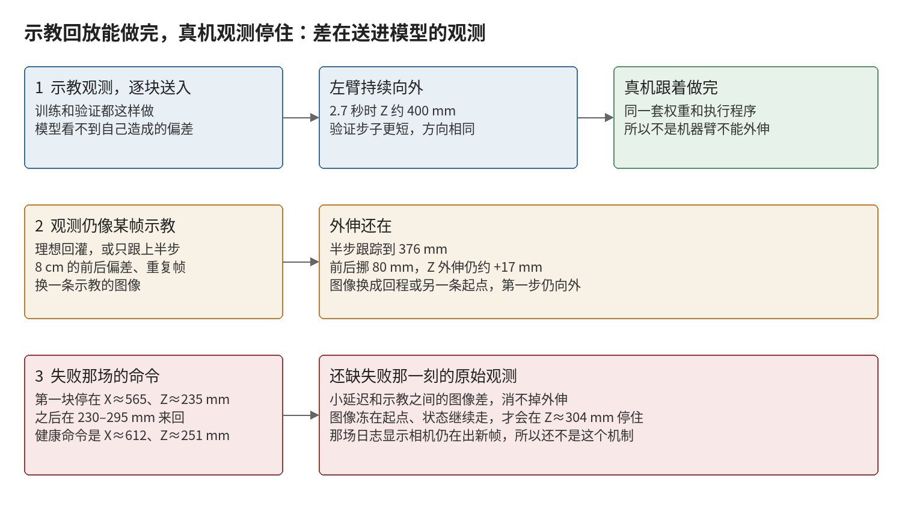

# 补充实验：示教回放好，真机观测停住

日期：2026-10-17。权重是 `2026.10.16/23.09.56_tianji_rail` 的 epoch 50 `ema_model`，SHA256 `575b901e0aa801437046789d3ae626969943043f0d8a2307acb88d4b158286d3`。CPU、每次预测前种子 42，除非另行写出种子。不连接设备。

## 问题

训练片段和验证片段都是把示教里的图像和状态按时间送进模型，再把预测动作交给真机。这两段都能做完，验证段稍差。换成真机自己的观测后，左臂停在外侧大约 230–295 mm，不再像示教那样伸到 450 mm 附近。

示教回放不把执行结果送回模型。真机评估送回的是当时的相机和本体状态。补充实验只改观测，看哪一种改动会把外伸命令变成失败记录里的那种短命令。

失败记录 `motion-sync-028` 的第一块 8 步，左臂目标停在 X 565–571 mm、Z 233–251 mm，末步是 (570, 133, 237) mm。同一模型在示教起点上的末步是 (612, 118, 251) mm。

## 做法

脚本 `scripts/probe_tianji_obs_gap.py` 和 `scripts/probe_tianji_obs_gap_extra.py`。数据是本机的 `episode_000000`（训练）和 `episode_000034`（验证）。结果在 `data/input_diagnosis/live_obs_gap_20261017/`。

外伸量定义为：8 步动作最后一步的左臂 Z，减去这份观测自己最新的左臂 Z。示教起点上，专家这一段大约外伸 26 mm。

## 结果

参考窗口 `episode_000000` 第 0 帧与诊断包里的 npz 逐元素相同。本机预测的末步左臂 XYZ 与服务器记录相差 0.0 mm。

五个种子下，第一步外伸：

| 观测 | 外伸范围 | 平均 |
|---|---|---|
| 训练起点 | +16 到 +29 mm | +22 mm |
| 验证起点 | +4 到 +17 mm | +10 mm |
| 训练 1 秒 | +18 到 +31 mm | +24 mm |
| 验证 1 秒 | +10 到 +22 mm | +15 mm |

验证段逐块使用原观测时，2.4 秒时左臂 Z 到 407 mm。训练段同样做法到约 400 mm。验证的步子更短，方向相同，最后仍离开失败记录所在的高度。

把观测改离示教之后：

| 改动 | 训练起点的 Z 外伸 |
|---|---|
| 原样 | +19 mm |
| 两帧都改成最新帧 | +20 mm |
| 图像换成验证段起点（腕部像素平均差 25） | +9 mm |
| 图像换成 13 秒回程（腕部像素平均差 84，位姿差 117 mm） | +23 mm |
| 左臂 X 向后移 60 mm | +17 mm，目标 X 落到 582 mm |
| 左臂 X 向后移 80 mm | +17 mm，目标 X 落到 573 mm |
| 左臂 Z 向外加 40 mm | 相对这份状态只剩 +2 mm，绝对 Z 是 274 mm |
| 状态整段换成回程 | 相对回程位姿为 −7 mm |

第 3 秒处，图像或状态滞后 4 帧、8 帧，外伸变化只有几毫米。

闭环，仍然使用示教里真实出现过的画面时：

- 预测状态回灌、图像按示教时钟前进：Z 到约 398 mm。
- 每步只执行预测位移的一半，再取位姿最接近的示教帧：2.7 秒时 Z 为 376 mm。
- 起点三路图像冻住，状态改成上一次预测：第一步仍外伸到 251 mm，随后停在 Z 304 mm、X 548 mm。

按预测位姿去找最近示教帧时，前 1.2 秒外伸到 388 mm；第 6 步命令离外伸段已有 47 mm，最近帧跳到了回程，Z 才掉头。这是查找跳到了另一段相似位姿，半步跟踪没有发生这次跳跃。

更细的单次替换见 `obs_gap.png`。左臂 Z 的归一化范围是 161–560 mm，上述目标都在范围里面。

## 判断

训练回放、验证回放和真机失败用的是同一份权重。验证回放稍差，对应第一步外伸平均少大约 12 mm，整段仍能伸到 400 mm 以上。真机失败是另一件事：命令从第一块起就停在起点高度，X 也比示教起点的健康命令少大约 50 mm。

下面这些改动留不住那个健康命令：重复最新帧、4 到 8 帧的错位、换用另一条示教或回程的图像、左臂 X 方向 80 mm 以内的偏差。观测只要还能对上示教里的某一帧，半步跟踪也会继续外伸。

能把外伸停掉的一种构造是：三路图像留在起点，本体状态改用模型自己的预测。它会在大约 1.5 秒后停在 Z 304 mm。失败日志里的相机时间戳仍在前进，而且第一块命令并不是先伸到 251 mm 再停，所以这场记录还对不上这个构造。

因此目前能确定的是：差在真机送进模型的那一帧观测，不在权重、动作下发，也不在验证集比训练集稍差。80 mm 以内的位置偏差和示教之间已有的图像差别，都还不够产生失败命令。

## 下一次只要采这一份

在示教回放能开始的那个姿态，不使能、不运动，保存三路原始图像和当时的末端、手状态。用现有脚本对这一份和 `episode_000000` 第 0 帧做四种组合：两边原样、只换图像、只换状态。

- 真机状态的左臂 X 已经远离 626 mm，或位姿接近回程：状态本身就足以改变命令，先核对起点和读数。
- 真机状态离示教起点只有一两厘米，但只有换上真机图像时外伸消失：图像差别大于这两条示教之间的差别，再对画面、机位和曝光。
- 真机图像停在初始画面，而状态已经往外走：对应上面 Z 304 mm 的停住；这场旧日志的时间戳并不支持它，新的一份可以当场证实或排除。
