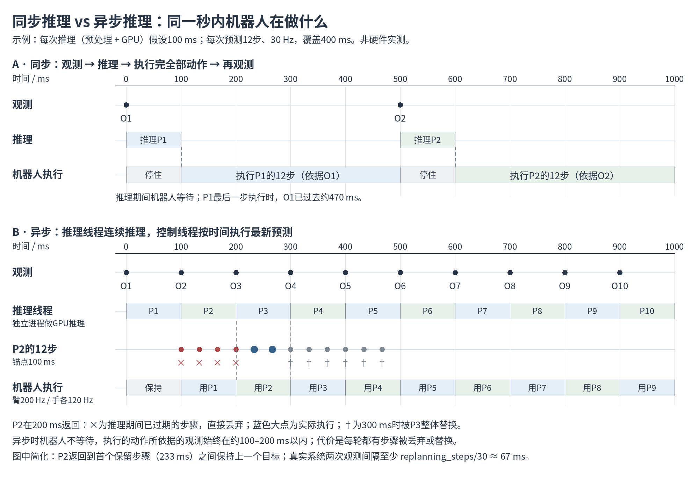

# Tianji 真机评估：新增同步推理模式

更新日期：2026-10-16

状态：已实现，离线测试通过（34 项）；同步模式尚未做真机影子或运动验收。在保留现有异步推理（默认）的前提下，为天机导轨真机评估新增同步推理模式。模式由部署配置 `inference_mode` 选择，命令行 `--inference-mode` 可以覆盖。

## 目标与语义

同步模式的语义与 [08-sync-vs-async.png](../docs/tianji-rail/task_flow_explanation/08-sync-vs-async.png) 中的图 A 一致：

- **异步模式（`async`，默认，行为不变）**：推理线程连续推理，动作沿用以观测锚点为起点的时间戳，推理期间已过期的步骤丢弃，新预测替换未来队列。
- **同步模式（`sync`，新增）**：每一轮按以下顺序执行：
  1. 等待上一个动作块执行完毕；
  2. 取一个锚点晚于完成时刻的新观测；
  3. 推理，期间机器人保持上一个动作块的最后目标；
  4. 返回的 `n_action_steps` 步（当前 checkpoint 为 8 步，约 267 ms）从提交时刻加上 `submit_margin_s` 重新计时，全部执行，不丢弃任何步骤；
  5. 执行完毕后回到第 1 步。
- 每轮执行的是 `predict_action()["action"]` 返回的 `n_action_steps` 步，不是模型内部 `horizon=16` 的全部 `action_pred`。
- 两种模式共用这些部分：`PolicyInferenceProcess` 推理子进程、臂 200 Hz / 手 120 Hz 控制线程、安全校验（`validate_actions`）和事件记录。区别只在"何时观测"和"动作时间戳怎么定"这两点。
- 同步模式下"保持不动"直接复用 Runtime 现有的保持分支（`active=False` 且 `arm_ready=True` 时，每个控制周期继续下发最后目标，机械臂看门狗不会超时），不调用 `pause()`，所以不会请求停臂。

## 模式选择

- [部署配置](../diffusion_policy/config/tianji_rail_real_eval.yaml) 新增 `inference_mode: async`，并加注释说明两种模式。
- [eval_tianji_rail.py](../eval_tianji_rail.py) 新增 `--inference-mode {async,sync}`，用法与现有的 `--device` 一致：命令行覆盖配置，最终值写回 `config`，这样 `session.json` 和 `trial.json` 中的 `deployment.inference_mode` 会自动记录实际使用的模式。启动时打印当前模式。
- `replanning_steps >= n_action_steps` 这项检查只在异步模式下做，因为同步模式不使用 `replanning_steps`。

## 各文件改动

**1. [tianji_policy_runtime.py](../diffusion_policy/real_world/tianji_policy_runtime.py)**
- 新增 `retimed_actions(actions, now_ns, hz, margin_s)`：输入检查与 `future_actions` 相同，时间戳为 `now + margin + k/hz`，`dropped=0`。
- `TianjiPolicyRuntime` 从 `config["inference_mode"]` 读取模式，新增两个状态：
  - `sync_waiting`：同步模式下，设备已接合、保持目标、正在等待下一次预测；
  - `chunk_completed_ns`：上一个动作块完成（或 `seed`）的时刻。
- `seed()`：在同步模式下置 `sync_waiting=arm_ready`，并置 `chunk_completed_ns=now`。`pause()`：清空这两个状态。
- `submit()`：同步模式下，如果动作块仍在执行就报错；否则改用 `retimed_actions`，并清空 `sync_waiting` 和 `chunk_completed_ns`。异步分支保持原样。
- `tick()`：同步模式下，当 `now >= _times[-1] + 1/policy_hz` 时不再报 "coverage expired" 故障，而是转入保持：`active=False`，`_last_action` 设为动作块最后一步，置 `sync_waiting=True` 并记录 `chunk_completed_ns`，再发出 `chunk_complete` 事件。异步模式下仍然按原逻辑报过期故障。
- 健康检查条件由 `if active` 扩展为 `if active or self.sync_waiting`，这样推理期间如果设备或数据流异常，仍会中止。等待期间臂或手失去接合，同样按故障中止。

**2. [tianji_rail_env.py](../diffusion_policy/real_world/tianji_rail_env.py)**
- `load_deployment_config`：校验 `inference_mode` 只能是 `async` 或 `sync`。
- `exec_actions`：影子模式加同步模式时，用 `retimed_actions` 生成 `shadow_schedule`，并记录模拟的完成时刻 `_shadow_chunk_end_ns`。运动模式仍然交给 `runtime.submit`。
- 新增 `chunk_completed_ns()`：运动模式返回 `runtime.chunk_completed_ns`；影子模式在当前时间到达模拟完成时刻后返回该时刻，否则返回 `None`。`pause()` 时重置影子完成时刻。
- `_collect` 中的健康检查条件同样扩展为 `runtime.active or runtime.sync_waiting`。

**3. [tianji_rail_real_runner.py](../diffusion_policy/env_runner/tianji_rail_real_runner.py)**（`_infer`）
- 同步分支：
  - 先取 `completed = env.chunk_completed_ns()`，如果是 `None` 就短暂等待后重试；
  - 观测锚点必须满足 `anchor > completed`，保证观测取自动作块执行完之后；
  - 跳过 `replanning_steps` 的锚点间隔检查；
  - `ObservationNotReady` 时重试，因为此时机器人在保持不动，设备健康由 Runtime 和采集线程负责监控。
- 在 `prediction` 事件中加入 `chunk_completed_ns`。
- 代际（generation）和 `_inference_lock` 的保护逻辑不变，停止时仍会丢弃正在进行中的预测。
- `timing_report`：如果事件中有 `chunk_completed_ns`，就统计 `sync_hold_ms`（从动作块完成到预测返回的时间，近似每轮的静止时长）。

**4. 测试 [test_tianji_rail_real_eval.py](../tests/test_tianji_rail_real_eval.py)**
- 同步 Runtime，使用假时钟：锚点已过去 300 ms 的预测在同步模式下 `dropped=0`，首步时刻为 `now + margin`；执行到动作块末尾后转入保持，不报故障，并继续下发最后目标；动作块执行中再次 `submit` 会被拒绝。
- 同步 Runner：只有当 `chunk_completed_ns` 非空且锚点晚于完成时刻时才调用推理。
- 配置：非法的 `inference_mode` 会被拒绝。
- 现有异步测试全部保留，作为回归检查。运行 `python -m pytest tests/test_tianji_rail_real_eval.py tests/test_policy_inference_process.py`。

**5. 文档**
- [docs/tianji-rail/README.md](../docs/tianji-rail/README.md) 第 5 节加入 `--inference-mode sync` 的用法和语义。现有的"过期动作不会平移后补发"只适用于异步模式，需要注明。
- [real_eval_structure/README.md](../docs/tianji-rail/real_eval_structure/README.md) 中 Runner 和重规划的描述各补一句同步模式。

## 注意事项

- 同步模式每轮的静止时长约等于"等待新帧（不超过约 33 ms 加采集延迟）+ 推理耗时 + `submit_margin_s`"，所以试验总时长会变长，必要时调大 `trial_timeout_s`。
- 重新计时的前提是推理期间机器人确实保持不动。第一步动作与保持目标之间仍然受 `max_position_jump_m` 等跳变限制约束，超限就拒绝下发。
- 如果推理卡住，机器人会一直保持；它由 `PolicyInferenceProcess` 的 10 s 请求超时和试验超时兜底，最终按故障中止。
