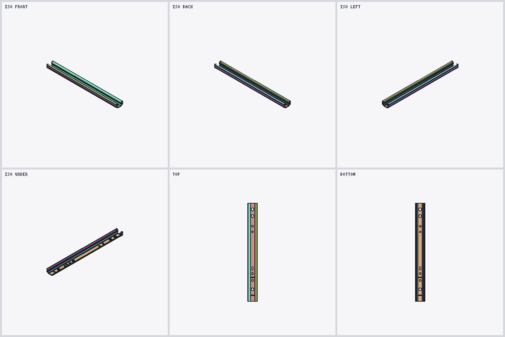

# 实物导轨 6D 位姿估计

本目录为完整源码快照中的导轨工作区；运行所需权重位于上一级 `weights/`，不是软链接。官方示例与历史结果提及的数据集、输出和部署归档未随源码复制；本项目可直接验证的三帧样本位于 diffusion_policy 的 `third_party/rail_assets/examples/rgbd/`。

复用 FoundationPose 预训练网络，估计导轨的 `T_C_CAD`。服务器做环境、CAD 和离线估计；本地 PC 接相机做实时验证。

## 1. 模型与坐标

CAD 原件：`input/model/source/导轨.SLDPRT`。推理网格：`input/model/rail.obj`（米，930 顶点，封闭）。包围尺寸约 **45.8 × 480 × 25.7 mm**，长轴为 CAD 的 Y 轴。原点未改，在导轨一端。



`T_C_CAD`：原始 CAD 系 → OpenCV 相机系（X 右、Y 下、Z 前），平移单位米，四元数 `xyzw`。显示坐标轴是 CAD 系，不是包围盒中心。

重新转网格（部署包已带处理好的 `rail.obj`，推理不必再转）：

```bash
python workspace/run.py prepare-model --source input/model/source/导轨.SLDPRT
```

支持 SLDPRT、STEP、OBJ、STL、PLY。OBJ/STL/PLY 必须加 `--source-unit m` 或 `mm`。

## 2. 环境

```bash
cd third_party/foundationpose  # 从 diffusion_policy 项目根目录进入
conda activate foundationpose
python workspace/run.py check-env
```

环境为 Python 3.11、PyTorch 2.7.1 cu128。版本锁定见 `requirements-lock.txt`。本地部署：解压 `deployment/foundationpose-rail.tar.gz` 后执行 `bash workspace/scripts/install.sh`（按本机 GPU 重编译扩展，不升级系统驱动）。GUI 命令必须在有显示的终端启动。

官方示例（验证环境）：

```bash
python workspace/run.py track \
  --scene datasets/official-smoke \
  --mesh datasets/official-download/mustard0/mesh/textured_simple.obj \
  --frames 30 --preview
```

空格暂停，`q` / Esc 退出。不加 `--preview` 只写文件。结果含 `poses.jsonl`、叠加图和 `summary.json`。指定 `--output` 时目录必须不存在。

## 3. 数据

工作区目录：

```text
scene.json            内参、时间与帧索引
rgb/<frame_id>.png    RGB
depth/<frame_id>.npy  float32 米；0 为无效
masks/<frame_id>.png  目标掩码，至少初始化那一帧需要
```

| 来源 | 命令 |
|---|---|
| 本机 RealSense 短采 | `run.py capture --serial <号> --frames 120 --preview --annotate-first` |
| 本机 D436 连续录 | `scripts/record_d436.py --serial <号> --preview --wait-start` |
| 遥操作 episode | `run.py import-episode --source <episode 目录> --camera camera_0 --output <scene>` |
| RealSense ROS 2 bag（`capture.db3`） | `run.py import-bag --source <录制目录> --output <scene>` |

`capture` 默认序列号 `348122072137`，640×480、30 Hz。标注：左键描轮廓，`a` 添加区域，`h` 排除孔或手，Enter 接受。深度对齐到 RGB，单位米。不要用有损的 `depth_preview.mp4` 当深度。`import-bag` 会丢掉 RGB/深度时间差大于 33 ms 的帧。

## 4. 估计

```bash
# 远程桌面画掩码；无显示时用 --polygon "x,y x,y ..."
python workspace/run.py annotate --scene <scene> --index 0

python workspace/run.py estimate --scene <scene>
python workspace/run.py track --scene <scene> --frames 120 --preview
# 从某一帧往回跟踪：--index N --reverse
```

实时：`python workspace/run.py live --serial <号>`。`i` / Enter 冻结并标注，`r` 重置，`s` 存图，`q` 退出。

`--preview` 算完一帧才显示一帧，并再等 100 ms，所以窗口慢于跟踪速度。要更快，先去掉 `--preview` 算完，再快放已有结果：

```bash
# 已有 mp4：2 倍速。3 倍速把 2 改成 3
ffplay -autoexit -vf "setpts=PTS/2" workspace/outputs/<结果目录>/review.mp4

# 只有叠加图时，按 60 帧/秒拼一段再播（文件名按帧号排序，即拍摄顺序）
ffmpeg -y -framerate 60 -pattern_type glob \
  -i 'workspace/outputs/<结果目录>/overlays/*.png' \
  -c:v libx264 -pix_fmt yuv420p /tmp/rail-preview.mp4
ffplay -autoexit /tmp/rail-preview.mp4
```

默认：批量 8、初始化精修 5 次、跟踪精修 2 次、FP32。显存不足时批量降为 4/2/1。跳变阈值（平移 0.1 m、旋转 45°）只是运行检查，不是精度。

**限制：** 导轨细长、两端常被手挡住时，单条跟踪可能沿长轴滑约 10 cm，首尾（绕 CAD Z 转 180°）也分不清。包围盒贴合 ≠ 孔销装配精度。

多条轨迹对比：

```bash
python workspace/scripts/review_episode.py --scene <scene> \
  --runs <track-a> <track-b> --output <复核目录>
python workspace/scripts/compare_tracks.py --scene <scene> \
  --runs <track-a> <track-b> --output <对比目录>
```

`review.mp4` 颜色：绿 confirmed，青 depth_selected，橙 ambiguous，红 contradicted。洋红点是 CAD 原点。

## 5. 已有结果

**episode_000010 / camera_0**（2026-10-19）：`outputs/episode10-cam0-result/`。1,269 帧中 1,229 帧有位姿；第 0–39 帧导轨被手臂挡住。`confirmed` 312，`depth_selected` 601，`ambiguous` 210，`contradicted` 106。料箱段沿长轴仍可能偏约 10 cm。

```bash
python workspace/run.py import-episode \
  --source datasets/rail_task_episode/episode_000010 \
  --camera camera_0 --output datasets/rail-episode-000010-camera0
python workspace/run.py track --scene datasets/rail-episode-000010-camera0 \
  --index 1268 --frames 1269 --reverse --preview \
  --output outputs/episode10-cam0-backward-from1268
xdg-open workspace/outputs/episode10-cam0-result/review.mp4
```

**rail_task_test2**（2026-10-20）：`outputs/rail-task-test2-backward-from698/`。导入 699 帧（跳过前 3 帧），从最后一帧倒序跟踪，全部通过运行检查。手持段（约 80–520）贴合较好；开头导轨未放到夹具上的帧不可信。

```bash
python workspace/run.py import-bag \
  --source datasets/rail_task_test2 --output datasets/rail-task-test2-camera0
python workspace/run.py track --scene datasets/rail-task-test2-camera0 \
  --index 698 --frames 699 --reverse --preview \
  --output outputs/rail-task-test2-backward-from698
```

## 6. 测试与打包

```bash
python -m pytest workspace/tests -q
python workspace/scripts/validate_gpu.py
python workspace/run.py package
```

服务器验证记录：`outputs/environment-check.json`、`outputs/validation.json`、`outputs/server-verification.json`。本地仍需核对实物尺寸、真实 RGB-D 和 GTX 1650 耗时。

第三方来源见 [来源说明](THIRD_PARTY_NOTICES.md)。
